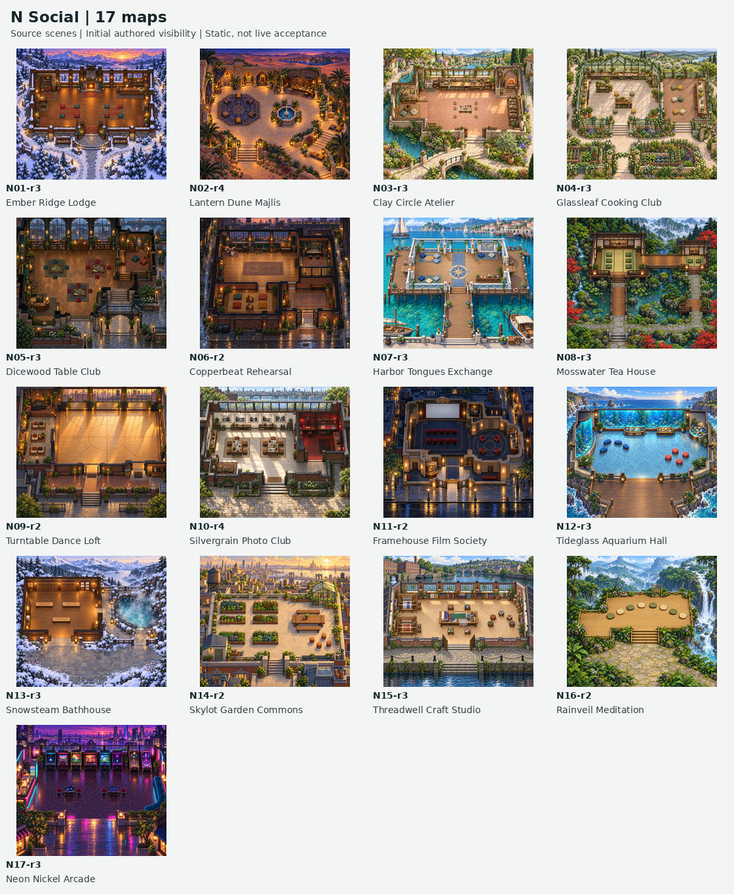
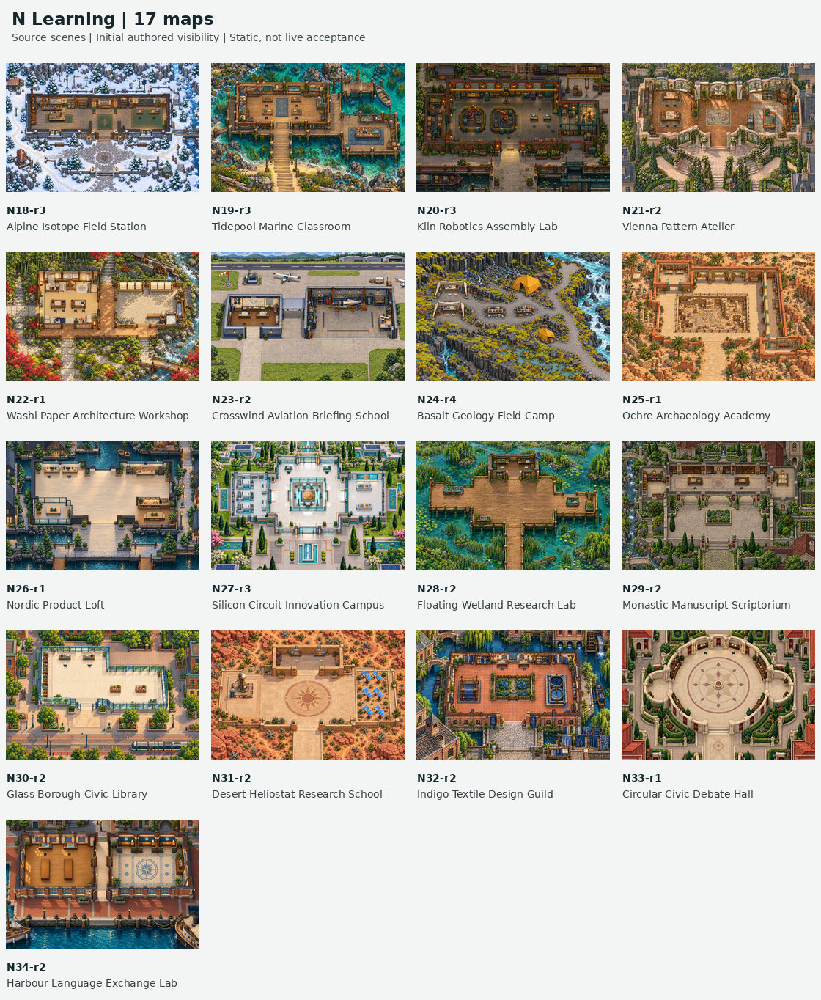
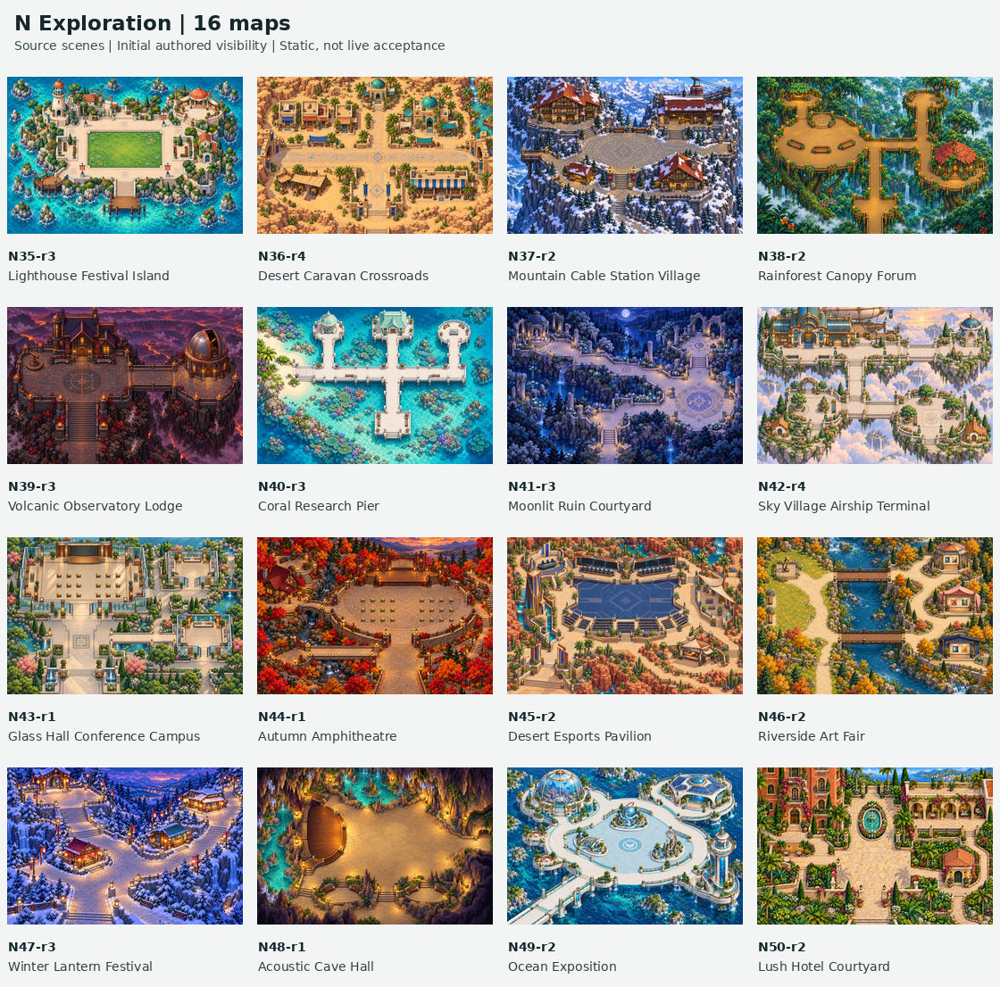
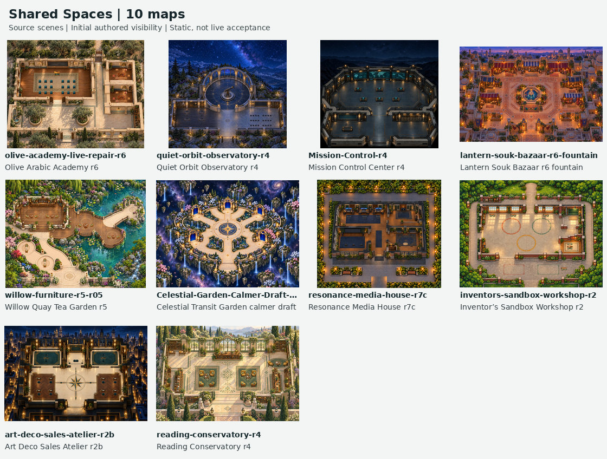
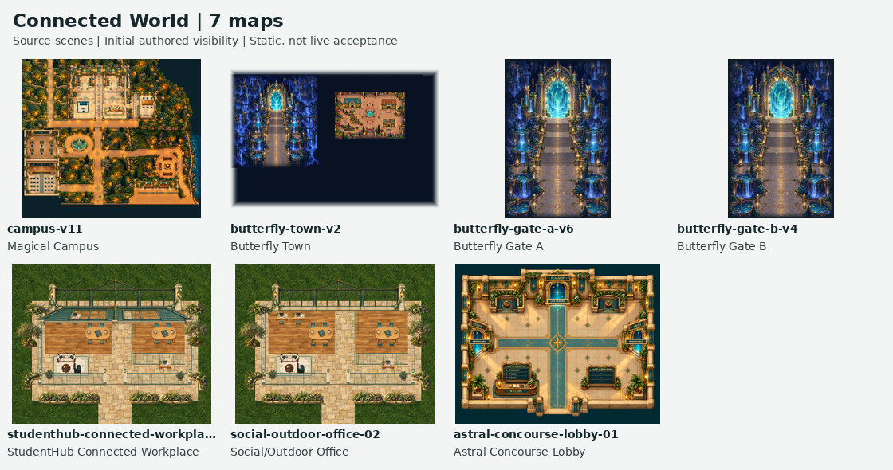
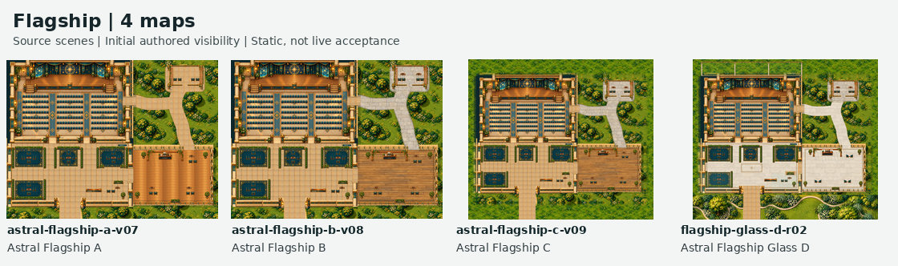
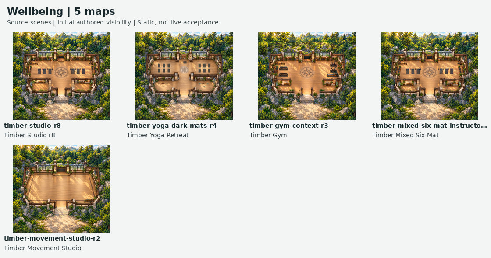
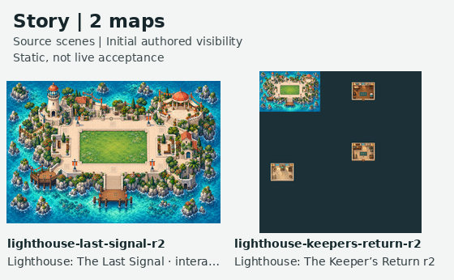
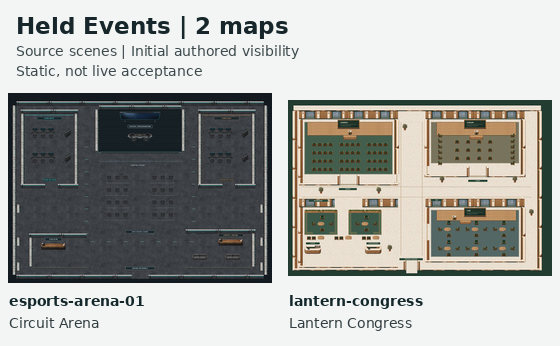

# Universe map collection

**80 recovered runtime candidates, with original-scene previews and exact files.** This catalogue covers the whole collection. It includes historical variants and rejected / paused references without treating them as newly approved maps.

**Public directory target:** [https://bawes-universe.github.io/universe-maps/recovered/2026-10-13-collection-v1/](https://bawes-universe.github.io/universe-maps/recovered/2026-10-13-collection-v1/). Publication / HTTP acceptance is recorded separately; a map-file URL is not a verified play-room link.

**Where we are:** the independent GitHub restore passed for all 596 original runtime files, 80 packages and 517 static dependency edges. Live rendering, gameplay and multiplayer acceptance remain open. There are currently no verified room links in this catalogue.

**Still missing:** 33 H original packages + Media r9; full original authoring for Studio r8, Reading r4 and Keeper r2. H025 / H039 nonvisual checkpoints do not add complete maps.

## Use the collection

1. Browse a family below, then copy the exact public **TMJ import URL** from its entry or the visual directory. Import / configure the matching WAM separately when needed.
2. Register isolated test rooms through an authenticated admin session. Do not paste a GitHub `/blob/` source page into a map importer.
3. Record tests against the exact revision / hash and deployed engine. Preserve review decisions; publishing a rejected reference does not approve it.
4. Continue the missing-original track separately. Do not substitute reconstructions or older variants for missing originals.

[Common acceptance checks](docs/map-testing/COMMON-CHECKS.md) · [Interactive / engine guide](docs/map-testing/EXPERIENCE-GUIDE.md) · [Restore receipt](docs/map-testing/RESTORE-RECEIPT.md) · [All 123 review cards](docs/map-testing/README.md) · [Preserved feedback](docs/map-testing/PRESERVED-FEEDBACK.md)

## Families

### [Social & leisure · 17](docs/map-collection/n-social.md)
N01–N17: distinct social settings. Their names describe spaces, not supplied arcade, film or game services.

[Ember Ridge Lodge](docs/map-collection/n-social.md#n01-r3-runtime) · [Lantern Dune Majlis](docs/map-collection/n-social.md#n02-r4-runtime) · [Clay Circle Atelier](docs/map-collection/n-social.md#n03-r3-runtime) · [Glassleaf Cooking Club](docs/map-collection/n-social.md#n04-r3-runtime) · [Dicewood Table Club](docs/map-collection/n-social.md#n05-r3-runtime) · [Copperbeat Rehearsal](docs/map-collection/n-social.md#n06-r2-runtime) · [Harbor Tongues Exchange](docs/map-collection/n-social.md#n07-r3-runtime) · [Mosswater Tea House](docs/map-collection/n-social.md#n08-r3-runtime) · [Turntable Dance Loft](docs/map-collection/n-social.md#n09-r2-runtime) · [Silvergrain Photo Club](docs/map-collection/n-social.md#n10-r4-runtime) · [Framehouse Film Society](docs/map-collection/n-social.md#n11-r2-runtime) · [Tideglass Aquarium Hall](docs/map-collection/n-social.md#n12-r3-runtime) · [Snowsteam Bathhouse](docs/map-collection/n-social.md#n13-r3-runtime) · [Skylot Garden Commons](docs/map-collection/n-social.md#n14-r2-runtime) · [Threadwell Craft Studio](docs/map-collection/n-social.md#n15-r3-runtime) · [Rainveil Meditation](docs/map-collection/n-social.md#n16-r2-runtime) · [Neon Nickel Arcade](docs/map-collection/n-social.md#n17-r3-runtime)

### [Learning & work · 17](docs/map-collection/n-learning.md)
N18–N34: classrooms, libraries, studios and workplaces. Check the configured features on each card.

[Alpine Isotope Field Station](docs/map-collection/n-learning.md#n18-r3-runtime) · [Tidepool Marine Classroom](docs/map-collection/n-learning.md#n19-r3-runtime) · [Kiln Robotics Assembly Lab](docs/map-collection/n-learning.md#n20-r3-runtime) · [Vienna Pattern Atelier](docs/map-collection/n-learning.md#n21-r2-runtime) · [Washi Paper Architecture Workshop](docs/map-collection/n-learning.md#n22-r1-runtime) · [Crosswind Aviation Briefing School](docs/map-collection/n-learning.md#n23-r2-runtime) · [Basalt Geology Field Camp](docs/map-collection/n-learning.md#n24-r4-runtime) · [Ochre Archaeology Academy](docs/map-collection/n-learning.md#n25-r1-runtime) · [Nordic Product Loft](docs/map-collection/n-learning.md#n26-r1-runtime) · [Silicon Circuit Innovation Campus](docs/map-collection/n-learning.md#n27-r3-runtime) · [Floating Wetland Research Lab](docs/map-collection/n-learning.md#n28-r2-runtime) · [Monastic Manuscript Scriptorium](docs/map-collection/n-learning.md#n29-r2-runtime) · [Glass Borough Civic Library](docs/map-collection/n-learning.md#n30-r2-runtime) · [Desert Heliostat Research School](docs/map-collection/n-learning.md#n31-r2-runtime) · [Indigo Textile Design Guild](docs/map-collection/n-learning.md#n32-r2-runtime) · [Circular Civic Debate Hall](docs/map-collection/n-learning.md#n33-r1-runtime) · [Harbour Language Exchange Lab](docs/map-collection/n-learning.md#n34-r2-runtime)

### [Exploration & events · 16](docs/map-collection/n-exploration.md)
N35–N50: destinations, gathering spaces and event settings. N35 Festival Island is separate from the two scripted lighthouse stories.

[Lighthouse Festival Island](docs/map-collection/n-exploration.md#n35-r3-runtime) · [Desert Caravan Crossroads](docs/map-collection/n-exploration.md#n36-r4-runtime) · [Mountain Cable Station Village](docs/map-collection/n-exploration.md#n37-r2-runtime) · [Rainforest Canopy Forum](docs/map-collection/n-exploration.md#n38-r2-runtime) · [Volcanic Observatory Lodge](docs/map-collection/n-exploration.md#n39-r3-runtime) · [Coral Research Pier](docs/map-collection/n-exploration.md#n40-r3-runtime) · [Moonlit Ruin Courtyard](docs/map-collection/n-exploration.md#n41-r3-runtime) · [Sky Village Airship Terminal](docs/map-collection/n-exploration.md#n42-r4-runtime) · [Glass Hall Conference Campus](docs/map-collection/n-exploration.md#n43-r1-runtime) · [Autumn Amphitheatre](docs/map-collection/n-exploration.md#n44-r1-runtime) · [Desert Esports Pavilion](docs/map-collection/n-exploration.md#n45-r2-runtime) · [Riverside Art Fair](docs/map-collection/n-exploration.md#n46-r2-runtime) · [Winter Lantern Festival](docs/map-collection/n-exploration.md#n47-r3-runtime) · [Acoustic Cave Hall](docs/map-collection/n-exploration.md#n48-r1-runtime) · [Ocean Exposition](docs/map-collection/n-exploration.md#n49-r2-runtime) · [Lush Hotel Courtyard](docs/map-collection/n-exploration.md#n50-r2-runtime)

### [Shared spaces · 10](docs/map-collection/shared-spaces.md)
Ten standalone shared-space candidates. The older archived Workshop, Souk and Academy revisions stay distinct from their newer hosted repairs.

[Olive Arabic Academy r6](docs/map-collection/shared-spaces.md#olive-academy-live-repair-r6-runtime) · [Quiet Orbit Observatory r4](docs/map-collection/shared-spaces.md#quiet-orbit-observatory-r4-runtime) · [Mission Control Center r4](docs/map-collection/shared-spaces.md#mission-control-r4-runtime) · [Lantern Souk Bazaar r6 fountain](docs/map-collection/shared-spaces.md#lantern-souk-bazaar-r6-fountain-runtime) · [Willow Quay Tea Garden r5](docs/map-collection/shared-spaces.md#willow-furniture-r5-r05-runtime) · [Celestial Transit Garden calmer draft](docs/map-collection/shared-spaces.md#celestial-garden-calmer-draft-runtime) · [Resonance Media House r7c](docs/map-collection/shared-spaces.md#resonance-media-house-r7c-runtime) · [Inventor’s Sandbox Workshop r2](docs/map-collection/shared-spaces.md#inventors-sandbox-workshop-r2-runtime) · [Art Deco Sales Atelier r2b](docs/map-collection/shared-spaces.md#art-deco-sales-atelier-r2b-runtime) · [Reading Conservatory r4](docs/map-collection/shared-spaces.md#reading-conservatory-r4-runtime)

### [Connected-world places · 7](docs/map-collection/connected-world.md)
Campus, gates, town and workplace experiments. Empty destination URLs and unconfigured services still need setup.

[Magical Campus](docs/map-collection/connected-world.md#campus-v11) · [Butterfly Town](docs/map-collection/connected-world.md#butterfly-town-v2) · [Butterfly Gate A](docs/map-collection/connected-world.md#butterfly-gate-a-v6) · [Butterfly Gate B](docs/map-collection/connected-world.md#butterfly-gate-b-v4) · [StudentHub Connected Workplace](docs/map-collection/connected-world.md#studenthub-connected-workplace-01) · [Social/Outdoor Office](docs/map-collection/connected-world.md#social-outdoor-office-02) · [Astral Concourse Lobby](docs/map-collection/connected-world.md#astral-concourse-lobby-01)

### [Flagship · four variants · 4](docs/map-collection/flagship.md)
One design family, four preserved alternatives. A/B/C are historical options; Glass D is a study. None is promoted to a newly approved replacement.

[Astral Flagship A](docs/map-collection/flagship.md#astral-flagship-a-v07) · [Astral Flagship B](docs/map-collection/flagship.md#astral-flagship-b-v08) · [Astral Flagship C](docs/map-collection/flagship.md#astral-flagship-c-v09) · [Astral Flagship Glass D](docs/map-collection/flagship.md#flagship-glass-d-r02)

### [Wellbeing designs · 5](docs/map-collection/wellbeing.md)
Studio plus four related Timber designs. Paused, rejected and unapproved revisions retain their review status.

[Timber Studio r8](docs/map-collection/wellbeing.md#timber-studio-r8-runtime) · [Timber Yoga Retreat](docs/map-collection/wellbeing.md#timber-yoga-dark-mats-r4) · [Timber Gym](docs/map-collection/wellbeing.md#timber-gym-context-r3) · [Timber Mixed Six-Mat](docs/map-collection/wellbeing.md#timber-mixed-six-mat-instructor-facing-r4) · [Timber Movement Studio](docs/map-collection/wellbeing.md#timber-movement-studio-r2)

### [Lighthouse stories · 2](docs/map-collection/story.md)
Two distinct scripted experiences: The Last Signal and The Keeper’s Return. These are the clearest quest-style candidates; runtime defects and engine gates are explicit.

[Lighthouse: The Last Signal · interactive map candidate r2](docs/map-collection/story.md#lighthouse-last-signal-r2-runtime) · [Lighthouse: The Keeper’s Return r2](docs/map-collection/story.md#lighthouse-keepers-return-r2-runtime)

### [Held event references · 2](docs/map-collection/held-events.md)
Circuit Arena and Lantern Congress were rejected. They remain available for reference, without reopening the decision.

[Circuit Arena](docs/map-collection/held-events.md#esports-arena-01-runtime) · [Lantern Congress](docs/map-collection/held-events.md#lantern-congress-runtime)

## Missing originals and next gates

[All 33 missing H originals](docs/map-collection/missing.md) · [Media r9](docs/map-testing/repairs.md#media-r9) · [H025 / H039 nonvisual checkpoint](recovery/nonvisual-h025-h039-2026-10-13/README.md)

**Important limits:** Keeper’s teleport race persists; Town audio is disabled; Media r7c service areas are empty; Campus / Gate / Concourse have unconfigured destinations or services. Map-rendering seams are not resolved by backup. Merged engine PRs #842 / #916 / #918 still need the deployed-build and live checks in the common checklist.

**Count carefully:** 80 is a package / candidate count. Flagship A/B/C/D are four variants of one family. The 123 review cards also include missing originals and historical / concept rows. No broader distinct-game count is asserted.

## Evidence

[Directory data](docs/map-collection/collection.json) · [Functional source crosswalk](docs/map-collection/functional-crosswalk.json) · [Preview manifest](docs/map-collection/preview-manifest.json) · [Preview QA](docs/map-collection/preview-validation.json) · [Reproducible renderer](tools/map-collection/README.md)

The existing test register and imported feedback are unchanged. New outcomes should be recorded on the matching revision card, not inferred from file availability.
