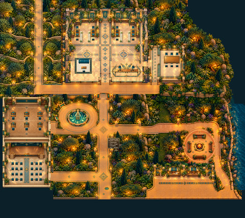
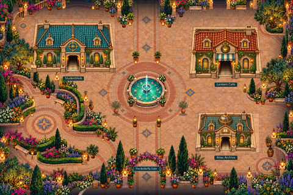
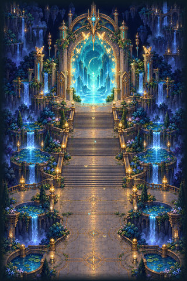
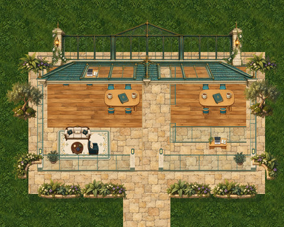
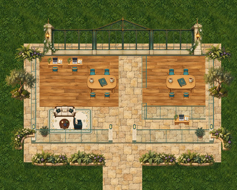
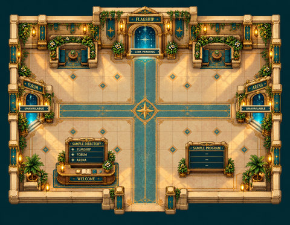

# Connected-world places

[← Whole collection](../../COLLECTION.md)

Campus, gates, town and workplace experiments. Empty destination URLs and unconfigured services still need setup.

**File links below are public import targets, not play rooms.** The original runtime backup is verified; publication checks and live acceptance are separate. Static previews are reconstructed from original TMJ / image bytes; no new art.

## Magical Campus
**campus-v11 · Existing reference**

A campus layout combining teaching, office work and informal gathering; its recovered runtime preserves the required cross-version assets and ambient-audio references.

**Configured in the files:** spatial layout (walkability untested), quiet-zone map property, WAM speaker/audience definitions, native animated tiles, native playAudio property.

**Limits / defects:** Six named campus services explicitly mark liveServiceConfigured=false; gateRoomUrl is empty. Map version property still says Revision10; catalogue identity is v11. Live services and inter-room linking are not established.

Preserved surviving runtime, unchanged. The review record distinguishes retained authoring, historical variants and incomplete master-source recovery.

[Full original-canvas preview](./previews/campus-v11.jpg) · [Exact source files, for review](https://github.com/BAWES-Universe/universe-maps/tree/9f80f9020df16993a4d1811552b0d816d403ccb1/archive/runtime-recovery-2026-10-13/campus-v11) · [Review / feedback](https://github.com/BAWES-Universe/universe-maps/blob/backup/map-source-recovery-2026-10-13/docs/map-testing/campus-flagship.md#campus-v11)

**Import files:**
- [publication/v11/map32/magical-campus.tmj public file](https://bawes-universe.github.io/universe-maps/recovered/2026-10-13-collection-v1/campus-v11/publication/v11/map32/magical-campus.tmj) — SHA-256 `1c7a9d27d434732453d706ac79dc482309db59a217d80f19b626d9380bc097ad`
- [publication/v11/map32/magical-campus.wam public file](https://bawes-universe.github.io/universe-maps/recovered/2026-10-13-collection-v1/campus-v11/publication/v11/map32/magical-campus.wam) — SHA-256 `5831ae09f48cfa68928eb02ccc51f83fe31b5036c23229a1a4f30c5ba8086013`

**Test next:**
- Load the full v11 subtree with its v9/v10 dependencies; check teaching, office and shared gathering routes.
- Test fountain/fire audio after gesture, zone exit and reconnect; verify any entity/camera behavior against the deployed engine revision.

**Play room:** no verified room URL.

## Butterfly Town
**butterfly-town-v2 · Additional recovered runtime**

An animated town/gate landscape with terrace cascades and a fountain. Native-audio code survives but is explicitly disabled in this candidate.

**Configured in the files:** spatial layout (walkability untested), native animated tiles, map script.

**Limits / defects:** Native audio is explicitly disabled by ENABLE_NATIVE_AUDIO = false. No verified current play room or current-engine/live acceptance.

Preserved surviving runtime, unchanged. The review record distinguishes retained authoring, historical variants and incomplete master-source recovery.

[Full original-canvas preview](./previews/butterfly-town-v2.png) · [Exact source files, for review](https://github.com/BAWES-Universe/universe-maps/tree/9f80f9020df16993a4d1811552b0d816d403ccb1/archive/runtime-recovery-2026-10-13/butterfly-town-v2) · [Review / feedback](https://github.com/BAWES-Universe/universe-maps/blob/backup/map-source-recovery-2026-10-13/docs/map-testing/campus-flagship.md#butterfly-town-v2)

**Import files:**
- [Butterfly-Town-v2/candidate/public/butterfly-town/v2/butterfly-town.tmj public file](https://bawes-universe.github.io/universe-maps/recovered/2026-10-13-collection-v1/butterfly-town-v2/Butterfly-Town-v2/candidate/public/butterfly-town/v2/butterfly-town.tmj) — SHA-256 `dff32360181d8e4c465756ab5e2f9577faad17083e2bfde19084eac8af749831`

**Test next:**
- Walk main roads, crossings and building approaches, checking full-body collision against the artwork.
- Native audio is disabled in the preserved script (ENABLE_NATIVE_AUDIO = false). Verify a compatible deployed #712 engine before proposing activation; this backup does not enable audio.

**Play room:** no verified room URL.

**Engine / runtime gates:**
- Native audio is intentionally disabled in the preserved script. Do not use this candidate to demonstrate an audible native-audio rollout.

## Butterfly Gate A
**butterfly-gate-a-v6 · Additional recovered runtime**

Gate A is one Butterfly-world entrance/arrival design, preserved separately from Gate B.

**Configured in the files:** spatial layout (walkability untested), native animated tiles, map script.

**Limits / defects:** campusRoomUrl is empty, so external travel is inactive. Audio-module presence is not a verified audible deployment. Live device/camera/exit tests remain.

Preserved surviving runtime, unchanged. The review record distinguishes retained authoring, historical variants and incomplete master-source recovery.

[Full original-canvas preview](./previews/butterfly-gate-a-v6.jpg) · [Exact source files, for review](https://github.com/BAWES-Universe/universe-maps/tree/9f80f9020df16993a4d1811552b0d816d403ccb1/archive/runtime-recovery-2026-10-13/butterfly-gate-a-v6) · [Review / feedback](https://github.com/BAWES-Universe/universe-maps/blob/backup/map-source-recovery-2026-10-13/docs/map-testing/campus-flagship.md#butterfly-gate-a-v6)

**Import files:**
- [gate/map/gate.tmj public file](https://bawes-universe.github.io/universe-maps/recovered/2026-10-13-collection-v1/butterfly-gate-a-v6/gate/map/gate.tmj) — SHA-256 `d284ee94a6c608903e3858efc30fcae12837d4ee7e89a6cf9f49c5a5cec8f104`

**Test next:**
- Test spawn framing, visible gate openings and onward approaches on desktop and phone.
- Keep gate/wall footprints solid; compare Gate A with Gate B without treating one as a revision of the other.

**Play room:** no verified room URL.

## Butterfly Gate B
**butterfly-gate-b-v4 · Existing reference**

Gate B is an alternative entrance/arrival design with balcony and boundary/camera review history.

**Configured in the files:** spatial layout (walkability untested), quiet-zone map property, native animated tiles, map script, native playAudio property.

**Limits / defects:** campusRoomUrl is empty, so external travel is inactive. Live audio, device/camera and exit tests remain.

Preserved surviving runtime, unchanged. The review record distinguishes retained authoring, historical variants and incomplete master-source recovery.

[Full original-canvas preview](./previews/butterfly-gate-b-v4.jpg) · [Exact source files, for review](https://github.com/BAWES-Universe/universe-maps/tree/9f80f9020df16993a4d1811552b0d816d403ccb1/archive/runtime-recovery-2026-10-13/butterfly-gate-b-v4) · [Review / feedback](https://github.com/BAWES-Universe/universe-maps/blob/backup/map-source-recovery-2026-10-13/docs/map-testing/campus-flagship.md#gate-v4)

**Import files:**
- [publish/public/butterfly-town/gate-b/v4/gate.tmj public file](https://bawes-universe.github.io/universe-maps/recovered/2026-10-13-collection-v1/butterfly-gate-b-v4/publish/public/butterfly-town/gate-b/v4/gate.tmj) — SHA-256 `9f92df380846507e5134d7ec42c977750df9d987514f845ccf0d1606211eebea`

**Test next:**
- Test arrival framing, balconies and boundaries at desktop and phone sizes; click near edges and return to the start.
- Verify intended silent/ambient zones and onward route behavior without assuming a current hosted URL.

**Play room:** no verified room URL.

## StudentHub Connected Workplace
**studenthub-connected-workplace-01 · Additional recovered runtime**

An experimental connected-workplace proof linking individual workstations and collaboration spaces.

**Configured in the files:** spatial layout (walkability untested), quiet-zone map property, map script.

**Limits / defects:** Roof-reveal script is not a quest or proof of configured communication services; live area/roof/body tests remain.

Preserved surviving runtime, unchanged. The review record distinguishes retained authoring, historical variants and incomplete master-source recovery.

[Full original-canvas preview](./previews/studenthub-connected-workplace-01.jpg) · [Exact source files, for review](https://github.com/BAWES-Universe/universe-maps/tree/9f80f9020df16993a4d1811552b0d816d403ccb1/archive/runtime-recovery-2026-10-13/studenthub-connected-workplace-01) · [Review / feedback](https://github.com/BAWES-Universe/universe-maps/blob/backup/map-source-recovery-2026-10-13/docs/map-testing/campus-flagship.md#studenthub-connected-workplace-01)

**Import files:**
- [studenthub-connected-workplace/map/studenthub-proof.tmj public file](https://bawes-universe.github.io/universe-maps/recovered/2026-10-13-collection-v1/studenthub-connected-workplace-01/studenthub-connected-workplace/map/studenthub-proof.tmj) — SHA-256 `0a70a16ef729d66939899d12f04de3c2b1ae7ab635dae1c9c43b60a56b8ca8be`

**Test next:**
- Try workstations, collaboration areas and all connecting routes with two users.
- Check standing/seating arrivals, proximity behavior and reconnect cleanup on the selected engine build.

**Play room:** no verified room URL.

## Social/Outdoor Office
**social-outdoor-office-02 · Additional recovered runtime**

An experimental social/outdoor office layout with a spawn/proximity repair and indoor/outdoor collaboration routes.

**Configured in the files:** spatial layout (walkability untested), quiet-zone map property.

**Limits / defects:** No runtime script or companion WAM supplied in this recovered package; dedicated services are not established.

Preserved surviving runtime, unchanged. The review record distinguishes retained authoring, historical variants and incomplete master-source recovery.

[Full original-canvas preview](./previews/social-outdoor-office-02.jpg) · [Exact source files, for review](https://github.com/BAWES-Universe/universe-maps/tree/9f80f9020df16993a4d1811552b0d816d403ccb1/archive/runtime-recovery-2026-10-13/social-outdoor-office-02) · [Review / feedback](https://github.com/BAWES-Universe/universe-maps/blob/backup/map-source-recovery-2026-10-13/docs/map-testing/campus-flagship.md#social-outdoor-office-02)

**Import files:**
- [spawn-proximity-repair-01/candidates/social-outdoor-office-02/map/studenthub-outdoor-office.tmj public file](https://bawes-universe.github.io/universe-maps/recovered/2026-10-13-collection-v1/social-outdoor-office-02/spawn-proximity-repair-01/candidates/social-outdoor-office-02/map/studenthub-outdoor-office.tmj) — SHA-256 `0e1d34ac9094a1d882e7145009679dec39d9fa8de963a83b76e3a0a8c9f9f618`

**Test next:**
- Test spawn proximity and movement between indoor/outdoor collaboration areas.
- Use two users to check conversation boundaries, real furniture collision and recovery after reconnect.

**Play room:** no verified room URL.

## Astral Concourse Lobby
**astral-concourse-lobby-01 · Additional recovered runtime**

A concourse lobby and arrival space intended to connect to event halls; onward destinations need room configuration.

**Configured in the files:** spatial layout (walkability untested), quiet-zone map property.

**Limits / defects:** Flagship destination is unconfigured; Forum and Arena markers explicitly say their halls are not built. Sample program is illustrative, not an event system.

Preserved surviving runtime, unchanged. The review record distinguishes retained authoring, historical variants and incomplete master-source recovery.

[Full original-canvas preview](./previews/astral-concourse-lobby-01.jpg) · [Exact source files, for review](https://github.com/BAWES-Universe/universe-maps/tree/9f80f9020df16993a4d1811552b0d816d403ccb1/archive/runtime-recovery-2026-10-13/astral-concourse-lobby-01) · [Review / feedback](https://github.com/BAWES-Universe/universe-maps/blob/backup/map-source-recovery-2026-10-13/docs/map-testing/campus-flagship.md#astral-concourse-lobby-01)

**Import files:**
- [astral-concourse-lobby-01/map32/astral-concourse-lobby.tmj public file](https://bawes-universe.github.io/universe-maps/recovered/2026-10-13-collection-v1/astral-concourse-lobby-01/astral-concourse-lobby-01/map32/astral-concourse-lobby.tmj) — SHA-256 `0d0ad1d16b4a434ad8e05cccdc490029f6ceb10656ab742e6002523384af9f15`
- [astral-concourse-lobby-01/map32/astral-concourse-lobby.wam public file](https://bawes-universe.github.io/universe-maps/recovered/2026-10-13-collection-v1/astral-concourse-lobby-01/astral-concourse-lobby-01/map32/astral-concourse-lobby.wam) — SHA-256 `8ad0faecb0ccf1949ba91f8c200359f6f19c772eddd15b0ae3c840d856a8c6ef`

**Test next:**
- Walk arrival, lobby and onward-hall approaches; inspect camera framing and native body clearance.
- Verify any portal/onward target is configured and authorized before recommending it as an entrance.

**Play room:** no verified room URL.

