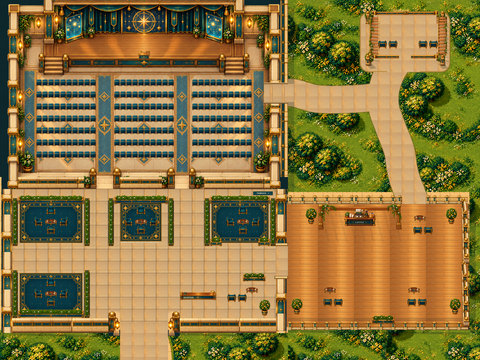
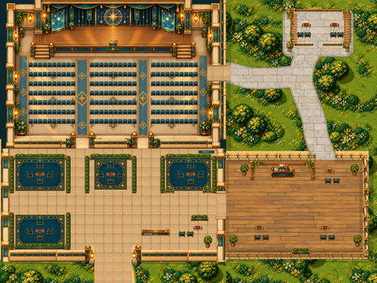
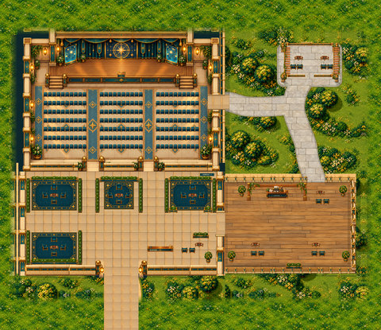
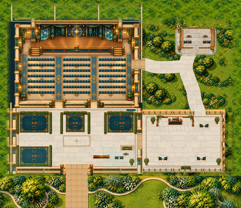

# Flagship · four variants

[← Whole collection](../../COLLECTION.md)

One design family, four preserved alternatives. A/B/C are historical options; Glass D is a study. None is promoted to a newly approved replacement.

**File links below are public import targets, not play rooms.** The original runtime backup is verified; publication checks and live acceptance are separate. Static previews are reconstructed from original TMJ / image bytes; no new art.

## Astral Flagship A
**astral-flagship-a-v07 · Historical option**

Flagship family option A: a large presentation hall, foyer and breakout-space layout. Historical option, not a new approval.

**Configured in the files:** spatial layout (walkability untested), quiet-zone map property, WAM speaker/audience definitions, WAM meeting-room definitions.

**Limits / defects:** Configured definitions are not live service acceptance. Historical option; not newly approved

Preserved surviving runtime, unchanged. The review record distinguishes retained authoring, historical variants and incomplete master-source recovery.

[Full original-canvas preview](./previews/astral-flagship-a-v07.jpg) · [Exact source files, for review](https://github.com/BAWES-Universe/universe-maps/tree/9f80f9020df16993a4d1811552b0d816d403ccb1/archive/runtime-recovery-2026-10-13/astral-flagship-a-v07) · [Review / feedback](https://github.com/BAWES-Universe/universe-maps/blob/backup/map-source-recovery-2026-10-13/docs/map-testing/campus-flagship.md#flagship-a)

**Import files:**
- [map32/grand-auditorium.tmj public file](https://bawes-universe.github.io/universe-maps/recovered/2026-10-13-collection-v1/astral-flagship-a-v07/map32/grand-auditorium.tmj) — SHA-256 `50c07de93567b15d7b5170bca02a4fe2b43dd5865fe02f6b90d06605947e2b85`
- [map32/grand-auditorium.wam public file](https://bawes-universe.github.io/universe-maps/recovered/2026-10-13-collection-v1/astral-flagship-a-v07/map32/grand-auditorium.wam) — SHA-256 `2504f5871750964aa6972f88bb4071ccbca73aa74847d84398637d18838954c2`

**Test next:**
- Compare foyer, stage and breakout circulation with later family feedback; preserve the liked stage and exterior approach.
- Treat lower-floor/terrace and glass choices as unresolved design work; do not mark A approved from another version’s source checks.

**Play room:** no verified room URL.

## Astral Flagship B
**astral-flagship-b-v08 · Historical option**

Flagship family option B: an alternative revision of the presentation-hall/foyer design, preserved for comparison.

**Configured in the files:** spatial layout (walkability untested), quiet-zone map property, WAM speaker/audience definitions, WAM meeting-room definitions, native animated tiles.

**Limits / defects:** Configured definitions are not live service acceptance. Historical option; not newly approved

Preserved surviving runtime, unchanged. The review record distinguishes retained authoring, historical variants and incomplete master-source recovery.

[Full original-canvas preview](./previews/astral-flagship-b-v08.jpg) · [Exact source files, for review](https://github.com/BAWES-Universe/universe-maps/tree/9f80f9020df16993a4d1811552b0d816d403ccb1/archive/runtime-recovery-2026-10-13/astral-flagship-b-v08) · [Review / feedback](https://github.com/BAWES-Universe/universe-maps/blob/backup/map-source-recovery-2026-10-13/docs/map-testing/campus-flagship.md#flagship-b)

**Import files:**
- [map32/grand-auditorium.tmj public file](https://bawes-universe.github.io/universe-maps/recovered/2026-10-13-collection-v1/astral-flagship-b-v08/map32/grand-auditorium.tmj) — SHA-256 `a9120457e63c3118de7a884879471b6219442bb26a72971f8c4ce163615e8f7b`
- [map32/grand-auditorium.wam public file](https://bawes-universe.github.io/universe-maps/recovered/2026-10-13-collection-v1/astral-flagship-b-v08/map32/grand-auditorium.wam) — SHA-256 `dd5a4d310640f82e6b4acc28f068733142b8f5f9bc3f0bda384c7fd3c00467f5`

**Test next:**
- Compare foyer, stage and breakout circulation with later family feedback; preserve the liked stage and exterior approach.
- Test stage/listener boundaries only on a separately approved isolated test deployment.

**Play room:** no verified room URL.

## Astral Flagship C
**astral-flagship-c-v09 · Historical option**

Flagship family option C: a later hall/foyer layout. Family feedback rejects the lower flooring and terrace while retaining the liked stage and exterior approach.

**Configured in the files:** spatial layout (walkability untested), quiet-zone map property, WAM speaker/audience definitions, WAM meeting-room definitions, native animated tiles, map script.

**Limits / defects:** Historical option with rejected lower flooring/terrace; glass study only. Requires real WAM/AV/roof-reveal testing; not an approved replacement.

Preserved surviving runtime, unchanged. The review record distinguishes retained authoring, historical variants and incomplete master-source recovery.

[Full original-canvas preview](./previews/astral-flagship-c-v09.jpg) · [Exact source files, for review](https://github.com/BAWES-Universe/universe-maps/tree/9f80f9020df16993a4d1811552b0d816d403ccb1/archive/runtime-recovery-2026-10-13/astral-flagship-c-v09) · [Review / feedback](https://github.com/BAWES-Universe/universe-maps/blob/backup/map-source-recovery-2026-10-13/docs/map-testing/campus-flagship.md#flagship-c)

**Import files:**
- [map32/grand-auditorium.tmj public file](https://bawes-universe.github.io/universe-maps/recovered/2026-10-13-collection-v1/astral-flagship-c-v09/map32/grand-auditorium.tmj) — SHA-256 `1f63e14e5fe656a4db00eda91cb52a961540e6e7a44bdeafd7ec1c5daf44dc9e`
- [map32/grand-auditorium.wam public file](https://bawes-universe.github.io/universe-maps/recovered/2026-10-13-collection-v1/astral-flagship-c-v09/map32/grand-auditorium.wam) — SHA-256 `d5fcbe0894c4fc6b6e03ecb89b0d5edd9536d42abddfeed9fd6bc89d0599bec7`

**Test next:**
- Review the rejected lower flooring and terrace before spending time on live acceptance.
- Preserve the liked stage/exterior approach and exact v09 reference; keep future design changes separate.

**Play room:** no verified room URL.

## Astral Flagship Glass D
**flagship-glass-d-r02 · Current candidate**

Flagship family option D: the glass/terrace study, with nine declared terrace collision-cell changes. This remains an unapproved design candidate.

**Configured in the files:** spatial layout (walkability untested), quiet-zone map property, WAM speaker/audience definitions, WAM meeting-room definitions, native animated tiles, map script.

**Limits / defects:** Study only; final design not approved. WAM import and live AV/roof/body tests remain.

Preserved surviving runtime, unchanged. The review record distinguishes retained authoring, historical variants and incomplete master-source recovery.

[Full original-canvas preview](./previews/flagship-glass-d-r02.jpg) · [Exact source files, for review](https://github.com/BAWES-Universe/universe-maps/tree/9f80f9020df16993a4d1811552b0d816d403ccb1/archive/runtime-recovery-2026-10-13/flagship-glass-d-r02) · [Review / feedback](https://github.com/BAWES-Universe/universe-maps/blob/backup/map-source-recovery-2026-10-13/docs/map-testing/campus-flagship.md#flagship-glass-d-r02)

**Import files:**
- [grand-auditorium.tmj public file](https://bawes-universe.github.io/universe-maps/recovered/2026-10-13-collection-v1/flagship-glass-d-r02/grand-auditorium.tmj) — SHA-256 `135665c51c1cb57f87d7c8b66d87d47a7db5b3d57e0da0be767c45054da1ee53`
- [grand-auditorium.wam public file](https://bawes-universe.github.io/universe-maps/recovered/2026-10-13-collection-v1/flagship-glass-d-r02/grand-auditorium.wam) — SHA-256 `d5fcbe0894c4fc6b6e03ecb89b0d5edd9536d42abddfeed9fd6bc89d0599bec7`

**Test next:**
- Compare lower flooring and terrace with the family rejection; preserve the liked stage/exterior approach.
- Inspect glass transparency and nine changed terrace collision cells with the native player; verify exits and breakout routes.

**Play room:** no verified room URL.

