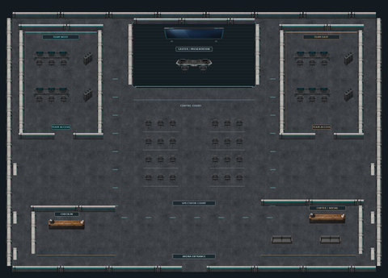
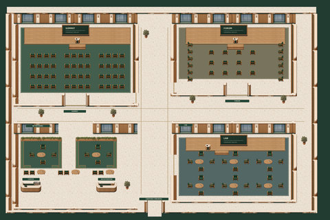

# Held event references

[← Whole collection](../../COLLECTION.md)

Circuit Arena and Lantern Congress were rejected. They remain available for reference, without reopening the decision.

**File links below are public import targets, not play rooms.** The original runtime backup is verified; publication checks and live acceptance are separate. Static previews are reconstructed from original TMJ / image bytes; no new art.

## Circuit Arena
**esports-arena-01 · Rejected reference**

A competitive-event/spectator template preserved as a rejected design reference.

**Configured in the files:** spatial layout (walkability untested), quiet-zone map property, WAM speaker/audience definitions, WAM meeting-room definitions.

**Limits / defects:** Configured definitions are not live service acceptance. Rejected reference; retained for history, not recommended

Preserved surviving runtime, unchanged. The review record distinguishes retained authoring, historical variants and incomplete master-source recovery.

[Full original-canvas preview](./previews/esports-arena-01-runtime.jpg) · [Exact source files, for review](https://github.com/BAWES-Universe/universe-maps/tree/9f80f9020df16993a4d1811552b0d816d403ccb1/archive/runtime-recovery-2026-10-13/esports-arena-01-runtime) · [Review / feedback](https://github.com/BAWES-Universe/universe-maps/blob/backup/map-source-recovery-2026-10-13/docs/map-testing/optional-archive.md#esports-event)

**Import files:**
- [esports-arena-01/map32/esports-arena.tmj public file](https://bawes-universe.github.io/universe-maps/recovered/2026-10-13-collection-v1/esports-arena-01-runtime/esports-arena-01/map32/esports-arena.tmj) — SHA-256 `b72cc096702debb18bd56bf19eeb012e197ce9b03c3b03a4a399244a0cd7ec89`
- [esports-arena-01/map32/esports-arena.wam public file](https://bawes-universe.github.io/universe-maps/recovered/2026-10-13-collection-v1/esports-arena-01-runtime/esports-arena-01/map32/esports-arena.wam) — SHA-256 `6355c478fb3ed26a5b2d7aa7991da000a6b834f896c02896f2b378226e3cc904`

**Test next:**

**Play room:** no verified room URL.

## Lantern Congress
**lantern-congress · Rejected reference**

A multi-hall conference template preserved as a rejected design reference.

**Configured in the files:** spatial layout (walkability untested), quiet-zone map property, WAM speaker/audience definitions, WAM meeting-room definitions.

**Limits / defects:** Configured definitions are not live service acceptance. Rejected reference; retained for history, not recommended

Preserved surviving runtime, unchanged. The review record distinguishes retained authoring, historical variants and incomplete master-source recovery.

[Full original-canvas preview](./previews/lantern-congress-runtime.jpg) · [Exact source files, for review](https://github.com/BAWES-Universe/universe-maps/tree/9f80f9020df16993a4d1811552b0d816d403ccb1/archive/runtime-recovery-2026-10-13/lantern-congress-runtime) · [Review / feedback](https://github.com/BAWES-Universe/universe-maps/blob/backup/map-source-recovery-2026-10-13/docs/map-testing/optional-archive.md#multi-hall-conference)

**Import files:**
- [map32/conference.tmj public file](https://bawes-universe.github.io/universe-maps/recovered/2026-10-13-collection-v1/lantern-congress-runtime/map32/conference.tmj) — SHA-256 `a1a3040a45384ae3380b90f479c327c35c5301e7e71a695c5a5f5fe628c84005`
- [map32/conference.wam public file](https://bawes-universe.github.io/universe-maps/recovered/2026-10-13-collection-v1/lantern-congress-runtime/map32/conference.wam) — SHA-256 `cdbab04682978c8aa6979daddeb5545504dea93db3c4327ebb0081638d7958bb`

**Test next:**

**Play room:** no verified room URL.

