# Exploration & events

[← Whole collection](../../COLLECTION.md)

N35–N50: destinations, gathering spaces and event settings. N35 Festival Island is separate from the two scripted lighthouse stories.

**File links below are public import targets, not play rooms.** The original runtime backup is verified; publication checks and live acceptance are separate. Static previews are reconstructed from original TMJ / image bytes; no new art.

## Lighthouse Festival Island
**N35-r3 · Current candidate**

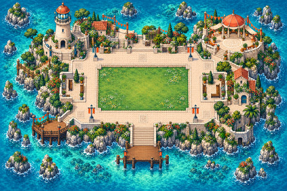

A festival island with a lighthouse, pavilion, benches and connected outdoor routes. This is separate from the two scripted lighthouse stories.

**Configured in the files:** spatial layout (walkability untested), quiet-zone map property.

**Limits / defects:** Named areas are empty setup placeholders, not installed learning activities, simulations or services. No quest script is present.

Recovered original authoring and exact runtime.

[Full original-canvas preview](./previews/N35-r3-runtime.jpg) · [Exact source files, for review](https://github.com/BAWES-Universe/universe-maps/tree/9f80f9020df16993a4d1811552b0d816d403ccb1/archive/runtime-recovery-2026-10-13/N35-r3-runtime) · [Review / feedback](https://github.com/BAWES-Universe/universe-maps/blob/backup/map-source-recovery-2026-10-13/docs/map-testing/n-exploration.md#n35)

**Import files:**
- [lighthouse-festival-island.tmj public file](https://bawes-universe.github.io/universe-maps/recovered/2026-10-13-collection-v1/N35-r3-runtime/lighthouse-festival-island.tmj) — SHA-256 `e977b32148d7d70e29b15114baee3db7327a982b4a2c33d07980dde909d3cf65`
- [lighthouse-festival-island.wam public file](https://bawes-universe.github.io/universe-maps/recovered/2026-10-13-collection-v1/N35-r3-runtime/lighthouse-festival-island.wam) — SHA-256 `ab7d1f6291d18c5eb4fd2ef8b8dc885e825e02da98a79fe7a1bf74f483555b6b`

**Test next:**
- Visit lighthouse and pavilion through repaired routes.
- East bench, columns, planters and balustrade retain collision; this is the N35 festival map, not either puzzle map.

**Play room:** no verified room URL.

## Desert Caravan Crossroads
**N36-r4 · Current candidate**

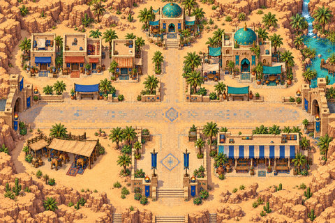

A caravan-crossroads setting with sand arrival, shops, a shrine and cleared corral approaches.

**Configured in the files:** spatial layout (walkability untested), quiet-zone map property.

**Limits / defects:** Named areas are empty setup placeholders, not installed learning activities, simulations or services. No quest script is present.

Recovered original authoring and exact runtime.

[Full original-canvas preview](./previews/N36-r4-runtime.jpg) · [Exact source files, for review](https://github.com/BAWES-Universe/universe-maps/tree/9f80f9020df16993a4d1811552b0d816d403ccb1/archive/runtime-recovery-2026-10-13/N36-r4-runtime) · [Review / feedback](https://github.com/BAWES-Universe/universe-maps/blob/backup/map-source-recovery-2026-10-13/docs/map-testing/n-exploration.md#n36)

**Import files:**
- [desert-caravan-crossroads.tmj public file](https://bawes-universe.github.io/universe-maps/recovered/2026-10-13-collection-v1/N36-r4-runtime/desert-caravan-crossroads.tmj) — SHA-256 `9f30ef8ff64ab1fdb1d69626fa5818db3938b8c4f66bcf4aa489ecb6fe206a64`
- [desert-caravan-crossroads.wam public file](https://bawes-universe.github.io/universe-maps/recovered/2026-10-13-collection-v1/N36-r4-runtime/desert-caravan-crossroads.wam) — SHA-256 `26f6568c980a7b6e12deb070e1e6b8f903d233c150862ae12054b8f6de63efdf`

**Test next:**
- Confirm arrival lands on clear sand, then reach shops, shrine and corral routes.
- Removed corral clutter must not leave invisible blocks; retained fixtures remain solid.

**Play room:** no verified room URL.

## Mountain Cable Station Village
**N37-r2 · Current candidate**

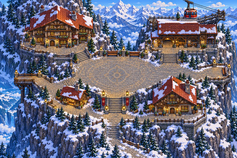

A cable-station village linked by plaza stairs to a lodge, overlooks and lower terraces.

**Configured in the files:** spatial layout (walkability untested), quiet-zone map property.

**Limits / defects:** Named areas are empty setup placeholders, not installed learning activities, simulations or services. No quest script is present.

Recovered original authoring and exact runtime.

[Full original-canvas preview](./previews/N37-r2-runtime.jpg) · [Exact source files, for review](https://github.com/BAWES-Universe/universe-maps/tree/9f80f9020df16993a4d1811552b0d816d403ccb1/archive/runtime-recovery-2026-10-13/N37-r2-runtime) · [Review / feedback](https://github.com/BAWES-Universe/universe-maps/blob/backup/map-source-recovery-2026-10-13/docs/map-testing/n-exploration.md#n37)

**Import files:**
- [mountain-cable-station-village.tmj public file](https://bawes-universe.github.io/universe-maps/recovered/2026-10-13-collection-v1/N37-r2-runtime/mountain-cable-station-village.tmj) — SHA-256 `0a49353b2dcdca146965458566bab521871b031fc14c2c4ade6a4e31bc4e06ca`
- [mountain-cable-station-village.wam public file](https://bawes-universe.github.io/universe-maps/recovered/2026-10-13-collection-v1/N37-r2-runtime/mountain-cable-station-village.wam) — SHA-256 `04daf118f9bf36189bc2c7601de083c03a86afd176e3328eafcd3e9400136f58`

**Test next:**
- Walk the southern trail fully to the scene edge.
- Use plaza stairs to station, lodge, overlooks and lower terraces without false barriers.

**Play room:** no verified room URL.

## Rainforest Canopy Forum
**N38-r2 · Current candidate**

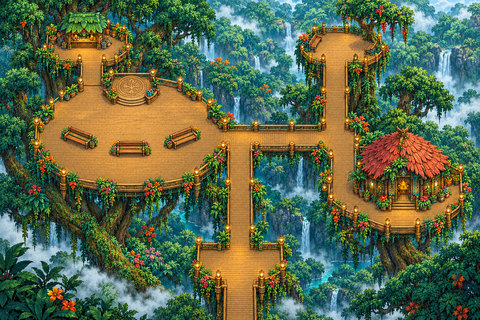

A rainforest forum with raised paths, railing boundaries and standing approaches to benches.

**Configured in the files:** spatial layout (walkability untested), quiet-zone map property.

**Limits / defects:** Named areas are empty setup placeholders, not installed learning activities, simulations or services. No quest script is present.

Recovered original authoring and exact runtime.

[Full original-canvas preview](./previews/N38-r2-runtime.jpg) · [Exact source files, for review](https://github.com/BAWES-Universe/universe-maps/tree/9f80f9020df16993a4d1811552b0d816d403ccb1/archive/runtime-recovery-2026-10-13/N38-r2-runtime) · [Review / feedback](https://github.com/BAWES-Universe/universe-maps/blob/backup/map-source-recovery-2026-10-13/docs/map-testing/n-exploration.md#n38)

**Import files:**
- [rainforest-canopy-forum.tmj public file](https://bawes-universe.github.io/universe-maps/recovered/2026-10-13-collection-v1/N38-r2-runtime/rainforest-canopy-forum.tmj) — SHA-256 `24920afcf88375c0340a09740400a7cc023a66375b66ed7fe93c301f4d7d269a`
- [rainforest-canopy-forum.wam public file](https://bawes-universe.github.io/universe-maps/recovered/2026-10-13-collection-v1/N38-r2-runtime/rainforest-canopy-forum.wam) — SHA-256 `06fd360784a5456319e9ed01d1c1d0ad3e7a3bebda4958cdc3a939e84fb496b7`

**Test next:**
- Walk every raised path and approach each bench from its standing position.
- Bench bodies and rail boundaries stay solid; standing approaches do not imply sitting animation.

**Play room:** no verified room URL.

## Volcanic Observatory Lodge
**N39-r3 · Current candidate**

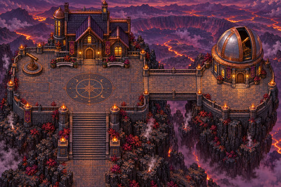

A volcanic-observatory lodge reached by bridge, broad stairs and doorway landings.

**Configured in the files:** spatial layout (walkability untested), quiet-zone map property.

**Limits / defects:** Named areas are empty setup placeholders, not installed learning activities, simulations or services. No quest script is present.

Recovered original authoring and exact runtime.

[Full original-canvas preview](./previews/N39-r3-runtime.jpg) · [Exact source files, for review](https://github.com/BAWES-Universe/universe-maps/tree/9f80f9020df16993a4d1811552b0d816d403ccb1/archive/runtime-recovery-2026-10-13/N39-r3-runtime) · [Review / feedback](https://github.com/BAWES-Universe/universe-maps/blob/backup/map-source-recovery-2026-10-13/docs/map-testing/n-exploration.md#n39)

**Import files:**
- [volcanic-observatory-lodge.tmj public file](https://bawes-universe.github.io/universe-maps/recovered/2026-10-13-collection-v1/N39-r3-runtime/volcanic-observatory-lodge.tmj) — SHA-256 `ac6f097436f2106cd70cf6375f1f22e5422dac279d07ae3b753a21586340f5eb`
- [volcanic-observatory-lodge.wam public file](https://bawes-universe.github.io/universe-maps/recovered/2026-10-13-collection-v1/N39-r3-runtime/volcanic-observatory-lodge.wam) — SHA-256 `ae1267d0361422a04b53d20c58de21cea94d16461e50fcbe9af54b77187f21d8`

**Test next:**
- Use bridge, broad stair and all doorway approaches.
- Both observatory planter bases stay solid; inspect visible-floor alignment.

**Play room:** no verified room URL.

## Coral Research Pier
**N40-r3 · Current candidate**

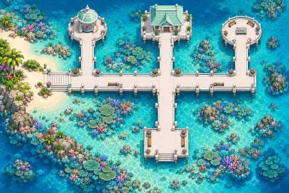

A research pier with a display tank and a reachable front approach between protected columns.

**Configured in the files:** spatial layout (walkability untested), quiet-zone map property.

**Limits / defects:** Named areas are empty setup placeholders, not installed learning activities, simulations or services. No quest script is present.

Recovered original authoring and exact runtime.

[Full original-canvas preview](./previews/N40-r3-runtime.jpg) · [Exact source files, for review](https://github.com/BAWES-Universe/universe-maps/tree/9f80f9020df16993a4d1811552b0d816d403ccb1/archive/runtime-recovery-2026-10-13/N40-r3-runtime) · [Review / feedback](https://github.com/BAWES-Universe/universe-maps/blob/backup/map-source-recovery-2026-10-13/docs/map-testing/n-exploration.md#n40)

**Import files:**
- [coral-research-pier.tmj public file](https://bawes-universe.github.io/universe-maps/recovered/2026-10-13-collection-v1/N40-r3-runtime/coral-research-pier.tmj) — SHA-256 `e3b5e44c8b43bf8e5b3f66dce642eade6738dfe78a296ff2df24d2a89fbdb1d9`
- [coral-research-pier.wam public file](https://bawes-universe.github.io/universe-maps/recovered/2026-10-13-collection-v1/N40-r3-runtime/coral-research-pier.wam) — SHA-256 `74945070417820dbd9974eec11ff9b4e1b91513a12c3822ee10d6d2563ac01d6`

**Test next:**
- Reach the display tank from its front approach.
- Tank and both side-column bases stay solid; test full-body clearance on the pier.

**Play room:** no verified room URL.

## Moonlit Ruin Courtyard
**N41-r3 · Current candidate**

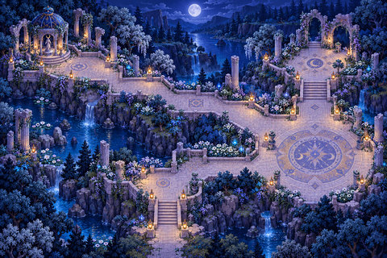

A moonlit ruin courtyard with zigzag stairs, connected terraces and urn-lined landings.

**Configured in the files:** spatial layout (walkability untested), quiet-zone map property.

**Limits / defects:** Named areas are empty setup placeholders, not installed learning activities, simulations or services. No quest script is present.

Recovered original authoring and exact runtime.

[Full original-canvas preview](./previews/N41-r3-runtime.jpg) · [Exact source files, for review](https://github.com/BAWES-Universe/universe-maps/tree/9f80f9020df16993a4d1811552b0d816d403ccb1/archive/runtime-recovery-2026-10-13/N41-r3-runtime) · [Review / feedback](https://github.com/BAWES-Universe/universe-maps/blob/backup/map-source-recovery-2026-10-13/docs/map-testing/n-exploration.md#n41)

**Import files:**
- [moonlit-ruin-courtyard.tmj public file](https://bawes-universe.github.io/universe-maps/recovered/2026-10-13-collection-v1/N41-r3-runtime/moonlit-ruin-courtyard.tmj) — SHA-256 `933915f23172c9bebcf4f962e32e32e356ea974edd4202d1b849cb7ef9d9d168`
- [moonlit-ruin-courtyard.wam public file](https://bawes-universe.github.io/universe-maps/recovered/2026-10-13-collection-v1/N41-r3-runtime/moonlit-ruin-courtyard.wam) — SHA-256 `ec9d1921c036771ec4e550962d5cac2994cdb20f8fdb5f8608b165a6e53d94ce`

**Test next:**
- Traverse zigzag stairs and connected terraces.
- Both southern urn bases stay solid; inspect foreground/player depth on landings.

**Play room:** no verified room URL.

## Sky Village Airship Terminal
**N42-r4 · Current candidate**

An airship-terminal village with connected bridges, pavilions and a fenced cottage arrival.

**Configured in the files:** spatial layout (walkability untested), quiet-zone map property.

**Limits / defects:** Named areas are empty setup placeholders, not installed learning activities, simulations or services. No quest script is present.

Recovered original authoring and exact runtime.

[Full original-canvas preview](./previews/N42-r4-runtime.jpg) · [Exact source files, for review](https://github.com/BAWES-Universe/universe-maps/tree/9f80f9020df16993a4d1811552b0d816d403ccb1/archive/runtime-recovery-2026-10-13/N42-r4-runtime) · [Review / feedback](https://github.com/BAWES-Universe/universe-maps/blob/backup/map-source-recovery-2026-10-13/docs/map-testing/n-exploration.md#n42)

**Import files:**
- [sky-village-airship-terminal.tmj public file](https://bawes-universe.github.io/universe-maps/recovered/2026-10-13-collection-v1/N42-r4-runtime/sky-village-airship-terminal.tmj) — SHA-256 `f5250de920da2f87bdda475018e261380558d8dfe619c456ef02104eb7d1da5e`
- [sky-village-airship-terminal.wam public file](https://bawes-universe.github.io/universe-maps/recovered/2026-10-13-collection-v1/N42-r4-runtime/sky-village-airship-terminal.wam) — SHA-256 `6f5b2e2a53c9d1e4e73a61639d95e36692def97fddc5aaf40adb169bc76226d9`

**Test next:**
- Arrive at the east cottage inside its fence on the real doorway apron.
- Traverse connected bridges and protect pavilion bases; avoid fence-crossing shortcuts.

**Play room:** no verified room URL.

## Glass Hall Conference Campus
**N43-r1 · Current candidate**

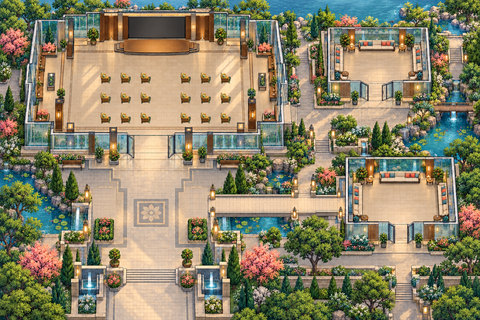

A glass conference hall with eighteen audience-chair positions and authored speaker/listener camera areas.

**Configured in the files:** spatial layout (walkability untested), quiet-zone map property, WAM speaker/audience definitions, WAM focusable framing.

**Limits / defects:** WAM definitions require import/configuration and live verification. No minigame or quest script is present.

Recovered original authoring and exact runtime.

[Full original-canvas preview](./previews/N43-r1-runtime.jpg) · [Exact source files, for review](https://github.com/BAWES-Universe/universe-maps/tree/9f80f9020df16993a4d1811552b0d816d403ccb1/archive/runtime-recovery-2026-10-13/N43-r1-runtime) · [Review / feedback](https://github.com/BAWES-Universe/universe-maps/blob/backup/map-source-recovery-2026-10-13/docs/map-testing/n-exploration.md#n43)

**Import files:**
- [glass-hall-conference-campus.tmj public file](https://bawes-universe.github.io/universe-maps/recovered/2026-10-13-collection-v1/N43-r1-runtime/glass-hall-conference-campus.tmj) — SHA-256 `48886ff4aa1541910a61a26c6636474c1fe468a414c8d11aaacbf41472608dba`
- [glass-hall-conference-campus.wam public file](https://bawes-universe.github.io/universe-maps/recovered/2026-10-13-collection-v1/N43-r1-runtime/glass-hall-conference-campus.wam) — SHA-256 `5603310a506de241620ecb97f7912d4fcd43fb0b12401959b28527852fab6c73`

**Test next:**
- Test all 18 native audience chair approaches and speaker/listener boundaries.
- Use two users to verify actual role/media behavior and whole-hall camera limits on the deployed engine.

**Play room:** no verified room URL.

## Autumn Amphitheatre
**N44-r1 · Current candidate**

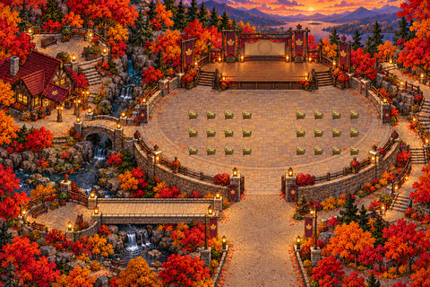

An outdoor amphitheatre with twenty-four audience-chair positions, a patio bridge and authored stage/audience areas.

**Configured in the files:** spatial layout (walkability untested), quiet-zone map property, WAM speaker/audience definitions, WAM focusable framing.

**Limits / defects:** WAM definitions require import/configuration and live verification. No minigame or quest script is present.

Recovered original authoring and exact runtime.

[Full original-canvas preview](./previews/N44-r1-runtime.jpg) · [Exact source files, for review](https://github.com/BAWES-Universe/universe-maps/tree/9f80f9020df16993a4d1811552b0d816d403ccb1/archive/runtime-recovery-2026-10-13/N44-r1-runtime) · [Review / feedback](https://github.com/BAWES-Universe/universe-maps/blob/backup/map-source-recovery-2026-10-13/docs/map-testing/n-exploration.md#n44)

**Import files:**
- [autumn-amphitheatre.tmj public file](https://bawes-universe.github.io/universe-maps/recovered/2026-10-13-collection-v1/N44-r1-runtime/autumn-amphitheatre.tmj) — SHA-256 `16698fef74238d0024d7ec1bdf9aa0cdb1110d1dc2eabadcc816dce6e0a07f4f`
- [autumn-amphitheatre.wam public file](https://bawes-universe.github.io/universe-maps/recovered/2026-10-13-collection-v1/N44-r1-runtime/autumn-amphitheatre.wam) — SHA-256 `747c2030b5bacbfc9c8e699e6fa2298145f77c44ae0c9a18e870c570a3b42fce`

**Test next:**
- Test 24 audience chair positions and both sides of the repaired patio bridge.
- Verify bounded speaker/listener areas and camera focus with two users, not just source configuration.

**Play room:** no verified room URL.

## Desert Esports Pavilion
**N45-r2 · Current candidate**

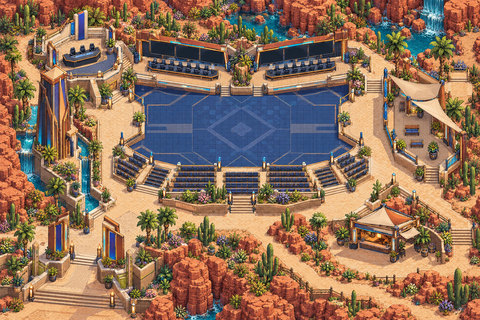

An esports-themed event pavilion with southwest entrance steps and authored speaker/audience camera bounds.

**Configured in the files:** spatial layout (walkability untested), quiet-zone map property, WAM speaker/audience definitions, WAM focusable framing.

**Limits / defects:** WAM definitions require import/configuration and live verification. No minigame or quest script is present.

Recovered original authoring and exact runtime.

[Full original-canvas preview](./previews/N45-r2-runtime.jpg) · [Exact source files, for review](https://github.com/BAWES-Universe/universe-maps/tree/9f80f9020df16993a4d1811552b0d816d403ccb1/archive/runtime-recovery-2026-10-13/N45-r2-runtime) · [Review / feedback](https://github.com/BAWES-Universe/universe-maps/blob/backup/map-source-recovery-2026-10-13/docs/map-testing/n-exploration.md#n45)

**Import files:**
- [desert-esports-pavilion.tmj public file](https://bawes-universe.github.io/universe-maps/recovered/2026-10-13-collection-v1/N45-r2-runtime/desert-esports-pavilion.tmj) — SHA-256 `35eea1f009d307ee1f6c932b42f76d56399ee0403ce60b3d7d3a0a622e204053`
- [desert-esports-pavilion.wam public file](https://bawes-universe.github.io/universe-maps/recovered/2026-10-13-collection-v1/N45-r2-runtime/desert-esports-pavilion.wam) — SHA-256 `1b9e457a552660c39956d74d2804ef2ba5dd61d3e356992475027337e90bf5c6`

**Test next:**
- Enter via southwest steps/apron from the lower scene edge.
- Verify speaker/audience camera bounds and event media with two users on desktop and phone.

**Play room:** no verified room URL.

## Riverside Art Fair
**N46-r2 · Current candidate**

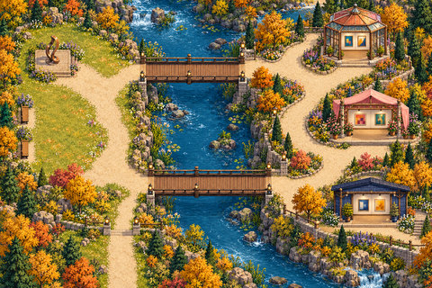

A riverside art-fair layout with stalls, bridge crossings, raised beds and a paved arrival.

**Configured in the files:** spatial layout (walkability untested), quiet-zone map property.

**Limits / defects:** Named areas are empty setup placeholders, not installed learning activities, simulations or services. No quest script is present.

Recovered original authoring and exact runtime.

[Full original-canvas preview](./previews/N46-r2-runtime.jpg) · [Exact source files, for review](https://github.com/BAWES-Universe/universe-maps/tree/9f80f9020df16993a4d1811552b0d816d403ccb1/archive/runtime-recovery-2026-10-13/N46-r2-runtime) · [Review / feedback](https://github.com/BAWES-Universe/universe-maps/blob/backup/map-source-recovery-2026-10-13/docs/map-testing/n-exploration.md#n46)

**Import files:**
- [riverside-art-fair.tmj public file](https://bawes-universe.github.io/universe-maps/recovered/2026-10-13-collection-v1/N46-r2-runtime/riverside-art-fair.tmj) — SHA-256 `e2e0c0ec4af61749924060f5ada9dd559447c45181ad68389622b59d336d1f75`
- [riverside-art-fair.wam public file](https://bawes-universe.github.io/universe-maps/recovered/2026-10-13-collection-v1/N46-r2-runtime/riverside-art-fair.wam) — SHA-256 `5752eea7ba9446be79864ebb2177510ff654fefad324535ced82a94989db5dc7`

**Test next:**
- Confirm arrival is on paving, then cross bridge and visit each stall route.
- Raised-bed feet, bridge rails and river banks remain protected.

**Play room:** no verified room URL.

## Winter Lantern Festival
**N47-r3 · Current candidate**

A winter lantern-festival setting with a paved west-overlook connector and lower-terrace route.

**Configured in the files:** spatial layout (walkability untested), quiet-zone map property.

**Limits / defects:** Named areas are empty setup placeholders, not installed learning activities, simulations or services. No quest script is present.

Recovered original authoring and exact runtime.

[Full original-canvas preview](./previews/N47-r3-runtime.jpg) · [Exact source files, for review](https://github.com/BAWES-Universe/universe-maps/tree/9f80f9020df16993a4d1811552b0d816d403ccb1/archive/runtime-recovery-2026-10-13/N47-r3-runtime) · [Review / feedback](https://github.com/BAWES-Universe/universe-maps/blob/backup/map-source-recovery-2026-10-13/docs/map-testing/n-exploration.md#n47)

**Import files:**
- [winter-lantern-festival.tmj public file](https://bawes-universe.github.io/universe-maps/recovered/2026-10-13-collection-v1/N47-r3-runtime/winter-lantern-festival.tmj) — SHA-256 `6f93d4f1b1f5d32d922c2e0bf57a8f13149b18f9acea084463da129aab2f7700`
- [winter-lantern-festival.wam public file](https://bawes-universe.github.io/universe-maps/recovered/2026-10-13-collection-v1/N47-r3-runtime/winter-lantern-festival.wam) — SHA-256 `a3f1f5a8a7e89a1b5d65cccc7bda4e5033614014672d16c49b9989f172f3e8da`

**Test next:**
- Reach the west overlook via its genuine paved connector and complete lower-terrace route.
- Repeat repaired branch clicks quickly and on touch; verify the latest destination wins.

**Play room:** no verified room URL.

## Acoustic Cave Hall
**N48-r1 · Current candidate**

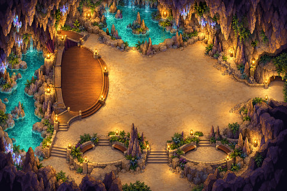

An acoustic-cave event hall with two stage approaches and authored speaker/listener camera areas.

**Configured in the files:** spatial layout (walkability untested), quiet-zone map property, WAM speaker/audience definitions, WAM focusable framing.

**Limits / defects:** WAM definitions require import/configuration and live verification. No minigame or quest script is present.

Recovered original authoring and exact runtime.

[Full original-canvas preview](./previews/N48-r1-runtime.jpg) · [Exact source files, for review](https://github.com/BAWES-Universe/universe-maps/tree/9f80f9020df16993a4d1811552b0d816d403ccb1/archive/runtime-recovery-2026-10-13/N48-r1-runtime) · [Review / feedback](https://github.com/BAWES-Universe/universe-maps/blob/backup/map-source-recovery-2026-10-13/docs/map-testing/n-exploration.md#n48)

**Import files:**
- [acoustic-cave-hall.tmj public file](https://bawes-universe.github.io/universe-maps/recovered/2026-10-13-collection-v1/N48-r1-runtime/acoustic-cave-hall.tmj) — SHA-256 `73f18ebf500aef88826eb06f59c2b374ff3765af5993dce60ac7684ffb4fd579`
- [acoustic-cave-hall.wam public file](https://bawes-universe.github.io/universe-maps/recovered/2026-10-13-collection-v1/N48-r1-runtime/acoustic-cave-hall.wam) — SHA-256 `5fca22804655469395430262635aad7a8950464161816d618c6cbaf73d10a3a9`

**Test next:**
- Reach stage from both approaches while respecting cave boundaries.
- Verify speaker/listener roles, audio/media cleanup and bounded camera focus with two users.

**Play room:** no verified room URL.

## Ocean Exposition
**N49-r2 · Current candidate**

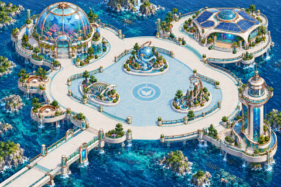

An exposition landscape with skeleton and orbital displays approached from dry paving.

**Configured in the files:** spatial layout (walkability untested), quiet-zone map property.

**Limits / defects:** Named areas are empty setup placeholders, not installed learning activities, simulations or services. No quest script is present.

Recovered original authoring and exact runtime.

[Full original-canvas preview](./previews/N49-r2-runtime.jpg) · [Exact source files, for review](https://github.com/BAWES-Universe/universe-maps/tree/9f80f9020df16993a4d1811552b0d816d403ccb1/archive/runtime-recovery-2026-10-13/N49-r2-runtime) · [Review / feedback](https://github.com/BAWES-Universe/universe-maps/blob/backup/map-source-recovery-2026-10-13/docs/map-testing/n-exploration.md#n49)

**Import files:**
- [ocean-exposition.tmj public file](https://bawes-universe.github.io/universe-maps/recovered/2026-10-13-collection-v1/N49-r2-runtime/ocean-exposition.tmj) — SHA-256 `78da585fe4a19ccbca6de12e546e97dcab186659dcb72684dca19854162ce0ed`
- [ocean-exposition.wam public file](https://bawes-universe.github.io/universe-maps/recovered/2026-10-13-collection-v1/N49-r2-runtime/ocean-exposition.wam) — SHA-256 `cb20a5a622280876dd981a234889e4254ab8960c8a21b5e1ebfd9d555268b3dd`

**Test next:**
- Reach skeleton and orbital display on real dry paving.
- Compound exhibit bases, rails and tree feet stay solid.

**Play room:** no verified room URL.

## Lush Hotel Courtyard
**N50-r2 · Current candidate**

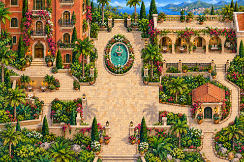

A lush hotel courtyard with a genuinely open arrival between solid gate leaves.

**Configured in the files:** spatial layout (walkability untested), quiet-zone map property.

**Limits / defects:** Named areas are empty setup placeholders, not installed learning activities, simulations or services. No quest script is present.

Recovered original authoring and exact runtime.

[Full original-canvas preview](./previews/N50-r2-runtime.jpg) · [Exact source files, for review](https://github.com/BAWES-Universe/universe-maps/tree/9f80f9020df16993a4d1811552b0d816d403ccb1/archive/runtime-recovery-2026-10-13/N50-r2-runtime) · [Review / feedback](https://github.com/BAWES-Universe/universe-maps/blob/backup/map-source-recovery-2026-10-13/docs/map-testing/n-exploration.md#n50)

**Import files:**
- [lush-hotel-courtyard.tmj public file](https://bawes-universe.github.io/universe-maps/recovered/2026-10-13-collection-v1/N50-r2-runtime/lush-hotel-courtyard.tmj) — SHA-256 `83b0f15a25d4340f12c772410eb6ca6b570c349552e91db8ab089f6cbd8c245f`
- [lush-hotel-courtyard.wam public file](https://bawes-universe.github.io/universe-maps/recovered/2026-10-13-collection-v1/N50-r2-runtime/lush-hotel-courtyard.wam) — SHA-256 `d477d480e07ad6c0394efeb62fd33bdd295c2ff23a731e99def93c5d5dc72dae`

**Test next:**
- Enter through the genuinely open arrival route between gate leaves.
- Gate artwork and leaf collision must agree; check courtyard furniture and edge paths.

**Play room:** no verified room URL.

