# Learning & work

[← Whole collection](../../COLLECTION.md)

N18–N34: classrooms, libraries, studios and workplaces. Check the configured features on each card.

**File links below are public import targets, not play rooms.** The original runtime backup is verified; publication checks and live acceptance are separate. Static previews are reconstructed from original TMJ / image bytes; no new art.

## Alpine Isotope Field Station
**N18-r3 · Current candidate**

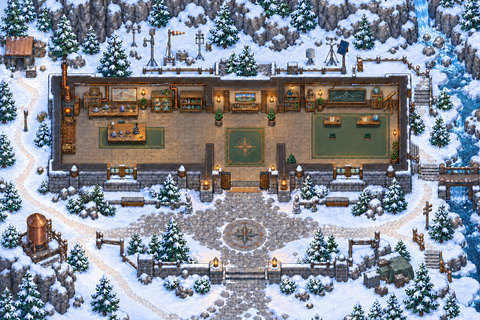

A laboratory and field-station setting with indoor worktables, an entrance and side paths.

**Configured in the files:** spatial layout (walkability untested), quiet-zone map property.

**Limits / defects:** Named areas are empty setup placeholders, not installed learning activities, simulations or services. No quest script is present.

Recovered original authoring and exact runtime.

[Full original-canvas preview](./previews/N18-r3-runtime.jpg) · [Exact source files, for review](https://github.com/BAWES-Universe/universe-maps/tree/9f80f9020df16993a4d1811552b0d816d403ccb1/archive/runtime-recovery-2026-10-13/N18-r3-runtime) · [Review / feedback](https://github.com/BAWES-Universe/universe-maps/blob/backup/map-source-recovery-2026-10-13/docs/map-testing/n-learning.md#n18)

**Import files:**
- [map32/map.tmj public file](https://bawes-universe.github.io/universe-maps/recovered/2026-10-13-collection-v1/N18-r3-runtime/map32/map.tmj) — SHA-256 `4cf2b4beb61a4344f8432cf944d315274b25675892ec874587e1c611979cbf32`
- [map32/map.wam public file](https://bawes-universe.github.io/universe-maps/recovered/2026-10-13-collection-v1/N18-r3-runtime/map32/map.wam) — SHA-256 `44c94e80e5cdb8891d22eddc3d8c5081b7b3c5374f112c25418be78dd739c711`

**Test next:**
- Traverse laboratory, entrance and both side paths; clear interior tile floor must remain open.
- Keep actual table feet solid and test desk arrivals with full body width.

**Play room:** no verified room URL.

## Tidepool Marine Classroom
**N19-r3 · Current candidate**

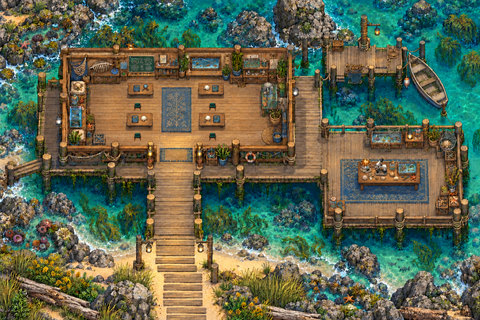

A marine-classroom layout with four shallow desks and continuous chair/aisle approaches.

**Configured in the files:** spatial layout (walkability untested), quiet-zone map property.

**Limits / defects:** Named areas are empty setup placeholders, not installed learning activities, simulations or services. No quest script is present.

Recovered original authoring and exact runtime.

[Full original-canvas preview](./previews/N19-r3-runtime.jpg) · [Exact source files, for review](https://github.com/BAWES-Universe/universe-maps/tree/9f80f9020df16993a4d1811552b0d816d403ccb1/archive/runtime-recovery-2026-10-13/N19-r3-runtime) · [Review / feedback](https://github.com/BAWES-Universe/universe-maps/blob/backup/map-source-recovery-2026-10-13/docs/map-testing/n-learning.md#n19)

**Import files:**
- [map32/map.tmj public file](https://bawes-universe.github.io/universe-maps/recovered/2026-10-13-collection-v1/N19-r3-runtime/map32/map.tmj) — SHA-256 `4c03dfe637b7f8693d5b6c55a872b50e23c4947f79a3626c2a1ec1c84b2b5eea`
- [map32/map.wam public file](https://bawes-universe.github.io/universe-maps/recovered/2026-10-13-collection-v1/N19-r3-runtime/map32/map.wam) — SHA-256 `f6bbacd9a9e26a5db63c2cc86ccb59398d95f5157127cd7bb8369107e3f515f7`

**Test next:**
- Use every classroom aisle and all four shallower desks.
- Verify real desk feet remain solid and native chair approaches fit.

**Play room:** no verified room URL.

## Kiln Robotics Assembly Lab
**N20-r3 · Current candidate**

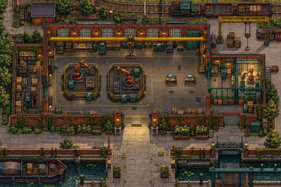

A robotics-workshop setting with consoles, two repositioned chairs and an open cross-floor route.

**Configured in the files:** spatial layout (walkability untested), quiet-zone map property.

**Limits / defects:** Named areas are empty setup placeholders, not installed learning activities, simulations or services. No quest script is present.

Recovered original authoring and exact runtime.

[Full original-canvas preview](./previews/N20-r3-runtime.jpg) · [Exact source files, for review](https://github.com/BAWES-Universe/universe-maps/tree/9f80f9020df16993a4d1811552b0d816d403ccb1/archive/runtime-recovery-2026-10-13/N20-r3-runtime) · [Review / feedback](https://github.com/BAWES-Universe/universe-maps/blob/backup/map-source-recovery-2026-10-13/docs/map-testing/n-learning.md#n20)

**Import files:**
- [map32/map.tmj public file](https://bawes-universe.github.io/universe-maps/recovered/2026-10-13-collection-v1/N20-r3-runtime/map32/map.tmj) — SHA-256 `1bff8502895530e20aace8b5ae40216651093498e93b3a10d65e54dce51972bd`
- [map32/map.wam public file](https://bawes-universe.github.io/universe-maps/recovered/2026-10-13-collection-v1/N20-r3-runtime/map32/map.wam) — SHA-256 `16f28d912c547f2b3c30f346fbc4d2d1dc3bf10e705bde63a638eb3f793fd5ed`

**Test next:**
- Cross the open floor and approach both moved chairs at their new locations.
- Console feet and actual rear legs stay solid; old chair positions must not retain ghost blocks.

**Play room:** no verified room URL.

## Vienna Pattern Atelier
**N21-r2 · Current candidate**

A pattern-design atelier with paired drafting-chair aisles and garden steps.

**Configured in the files:** spatial layout (walkability untested), quiet-zone map property.

**Limits / defects:** Named areas are empty setup placeholders, not installed learning activities, simulations or services. No quest script is present.

Recovered original authoring and exact runtime.

[Full original-canvas preview](./previews/N21-r2-runtime.jpg) · [Exact source files, for review](https://github.com/BAWES-Universe/universe-maps/tree/9f80f9020df16993a4d1811552b0d816d403ccb1/archive/runtime-recovery-2026-10-13/N21-r2-runtime) · [Review / feedback](https://github.com/BAWES-Universe/universe-maps/blob/backup/map-source-recovery-2026-10-13/docs/map-testing/n-learning.md#n21)

**Import files:**
- [map32/map.tmj public file](https://bawes-universe.github.io/universe-maps/recovered/2026-10-13-collection-v1/N21-r2-runtime/map32/map.tmj) — SHA-256 `d157119f542265ca0d74a2cf913ee53011af125ad61e8e2321f7cb7ba72d54a5`
- [map32/map.wam public file](https://bawes-universe.github.io/universe-maps/recovered/2026-10-13-collection-v1/N21-r2-runtime/map32/map.wam) — SHA-256 `bb03e6b6be3ab97b4fe52d28e4b50719ea29d57b584c3a3189be49a6cf8845f7`

**Test next:**
- Walk both paired-chair aisles and garden steps.
- Check the shallower upper drafting-table feet remain solid and arrivals are native-scale.

**Play room:** no verified room URL.

## Washi Paper Architecture Workshop
**N22-r1 · Current candidate**

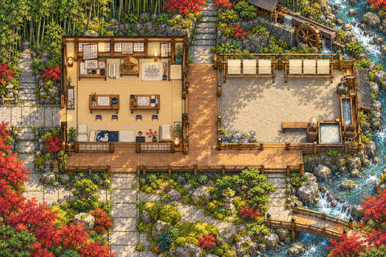

A paper-architecture workshop with broad entrances, straight circulation and cedar-and-indigo chairs.

**Configured in the files:** spatial layout (walkability untested), quiet-zone map property.

**Limits / defects:** Named areas are empty setup placeholders, not installed learning activities, simulations or services. No quest script is present.

Recovered original authoring and exact runtime.

[Full original-canvas preview](./previews/N22-r1-runtime.jpg) · [Exact source files, for review](https://github.com/BAWES-Universe/universe-maps/tree/9f80f9020df16993a4d1811552b0d816d403ccb1/archive/runtime-recovery-2026-10-13/N22-r1-runtime) · [Review / feedback](https://github.com/BAWES-Universe/universe-maps/blob/backup/map-source-recovery-2026-10-13/docs/map-testing/n-learning.md#n22)

**Import files:**
- [map32/map.tmj public file](https://bawes-universe.github.io/universe-maps/recovered/2026-10-13-collection-v1/N22-r1-runtime/map32/map.tmj) — SHA-256 `b7ccfe465862fc65f698dee37c6bd203a33c144f29e0ae4150eea700e58be759`
- [map32/map.wam public file](https://bawes-universe.github.io/universe-maps/recovered/2026-10-13-collection-v1/N22-r1-runtime/map32/map.wam) — SHA-256 `59c9f0092a7f8a24b884eb4449c2a15be39a3df41ec12f2159924ae4b9b4ebde`

**Test next:**
- Test broad entrances and straight circulation end to end.
- Check cedar/indigo chair arrivals and real workshop furniture footprints.

**Play room:** no verified room URL.

## Crosswind Aviation Briefing School
**N23-r2 · Current candidate**

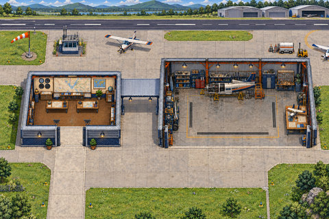

An aviation-briefing classroom with navigation desks and clear lower chair/cross-aisle floor.

**Configured in the files:** spatial layout (walkability untested), quiet-zone map property.

**Limits / defects:** Named areas are empty setup placeholders, not installed learning activities, simulations or services. No quest script is present.

Recovered original authoring and exact runtime.

[Full original-canvas preview](./previews/N23-r2-runtime.jpg) · [Exact source files, for review](https://github.com/BAWES-Universe/universe-maps/tree/9f80f9020df16993a4d1811552b0d816d403ccb1/archive/runtime-recovery-2026-10-13/N23-r2-runtime) · [Review / feedback](https://github.com/BAWES-Universe/universe-maps/blob/backup/map-source-recovery-2026-10-13/docs/map-testing/n-learning.md#n23)

**Import files:**
- [map32/map.tmj public file](https://bawes-universe.github.io/universe-maps/recovered/2026-10-13-collection-v1/N23-r2-runtime/map32/map.tmj) — SHA-256 `e4c738e1f45d02f8b530f04074aa2a85127ca7ffac86eafa77edc575976e80da`
- [map32/map.wam public file](https://bawes-universe.github.io/universe-maps/recovered/2026-10-13-collection-v1/N23-r2-runtime/map32/map.wam) — SHA-256 `f60f9869cb541d3fd8c10e384b345c1b57c2ea9f395c357653b97fc8b46e8f1a`

**Test next:**
- Cross the freed lower chair/cross-aisle floor after desk moves.
- Both navigation-desk feet must remain solid at their new positions.

**Play room:** no verified room URL.

## Basalt Geology Field Camp
**N24-r4 · Current candidate**

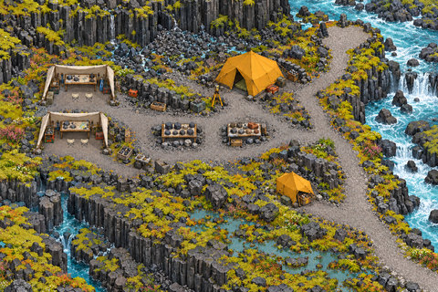

A geology field-camp setting with a lookout reached through a cleared rocky landscape.

**Configured in the files:** spatial layout (walkability untested), quiet-zone map property.

**Limits / defects:** Named areas are empty setup placeholders, not installed learning activities, simulations or services. No quest script is present.

Recovered original authoring and exact runtime.

[Full original-canvas preview](./previews/N24-r4-runtime.jpg) · [Exact source files, for review](https://github.com/BAWES-Universe/universe-maps/tree/9f80f9020df16993a4d1811552b0d816d403ccb1/archive/runtime-recovery-2026-10-13/N24-r4-runtime) · [Review / feedback](https://github.com/BAWES-Universe/universe-maps/blob/backup/map-source-recovery-2026-10-13/docs/map-testing/n-learning.md#n24)

**Import files:**
- [map32/map.tmj public file](https://bawes-universe.github.io/universe-maps/recovered/2026-10-13-collection-v1/N24-r4-runtime/map32/map.tmj) — SHA-256 `979cda465a06dd54f9e211ae1006abb8036b6d641cc2d62e2df47b8e9420fa36`
- [map32/map.wam public file](https://bawes-universe.github.io/universe-maps/recovered/2026-10-13-collection-v1/N24-r4-runtime/map32/map.wam) — SHA-256 `da1a341e743b66700a3a2bc948493e695cabd63fbf97fc816d1a07ff72d13000`

**Test next:**
- Reach the lookout through the real route where rocks were removed.
- Check retained ground structure and protected real rock/equipment footprints.

**Play room:** no verified room URL.

## Ochre Archaeology Academy
**N25-r1 · Current candidate**

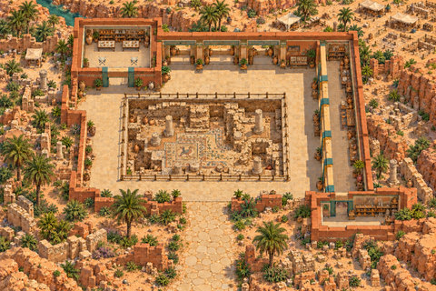

An archaeology academy with classroom access and a railed excavation viewing loop.

**Configured in the files:** spatial layout (walkability untested), quiet-zone map property.

**Limits / defects:** Named areas are empty setup placeholders, not installed learning activities, simulations or services. No quest script is present.

Recovered original authoring and exact runtime.

[Full original-canvas preview](./previews/N25-r1-runtime.jpg) · [Exact source files, for review](https://github.com/BAWES-Universe/universe-maps/tree/9f80f9020df16993a4d1811552b0d816d403ccb1/archive/runtime-recovery-2026-10-13/N25-r1-runtime) · [Review / feedback](https://github.com/BAWES-Universe/universe-maps/blob/backup/map-source-recovery-2026-10-13/docs/map-testing/n-learning.md#n25)

**Import files:**
- [map32/map.tmj public file](https://bawes-universe.github.io/universe-maps/recovered/2026-10-13-collection-v1/N25-r1-runtime/map32/map.tmj) — SHA-256 `b89cfec16355f2055945f0dfe42cccddc8e3fad9db43cf9268d686b1cc37227a`
- [map32/map.wam public file](https://bawes-universe.github.io/universe-maps/recovered/2026-10-13-collection-v1/N25-r1-runtime/map32/map.wam) — SHA-256 `3b09206b6609b693e48fd5b69fa397dfc1a5f6f01978ba445f32a72a44738dd0`

**Test next:**
- Use broad classroom access and the entire excavation viewing loop.
- Pit railing must prevent stepping into the excavation.

**Play room:** no verified room URL.

## Nordic Product Loft
**N26-r1 · Current candidate**

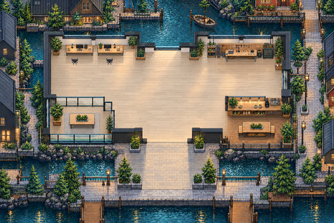

A product-design loft connecting studio, café, bridge, street and pier.

**Configured in the files:** spatial layout (walkability untested), quiet-zone map property.

**Limits / defects:** Named areas are empty setup placeholders, not installed learning activities, simulations or services. No quest script is present.

Recovered original authoring and exact runtime.

[Full original-canvas preview](./previews/N26-r1-runtime.jpg) · [Exact source files, for review](https://github.com/BAWES-Universe/universe-maps/tree/9f80f9020df16993a4d1811552b0d816d403ccb1/archive/runtime-recovery-2026-10-13/N26-r1-runtime) · [Review / feedback](https://github.com/BAWES-Universe/universe-maps/blob/backup/map-source-recovery-2026-10-13/docs/map-testing/n-learning.md#n26)

**Import files:**
- [map32/map.tmj public file](https://bawes-universe.github.io/universe-maps/recovered/2026-10-13-collection-v1/N26-r1-runtime/map32/map.tmj) — SHA-256 `116323ca8344b34a43186865e0470820ebe52816c4f49437cf9006779aa67050`
- [map32/map.wam public file](https://bawes-universe.github.io/universe-maps/recovered/2026-10-13-collection-v1/N26-r1-runtime/map32/map.wam) — SHA-256 `1ef65c2543f6c99c2ebca7815ea8326d2e6bf3e8f5641d6cf9168ebbe428be3b`

**Test next:**
- Traverse studio, café, bridge, street and pier as one connected route.
- Check native chairs and low rails without losing head/body visibility.

**Play room:** no verified room URL.

## Silicon Circuit Innovation Campus
**N27-r3 · Current candidate**

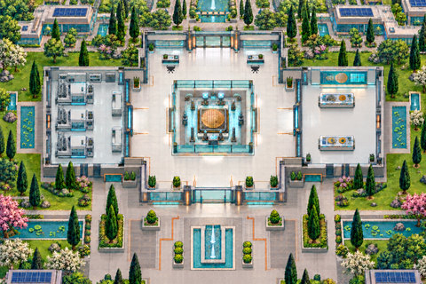

An innovation-campus setting with separated demonstration tables and usable native-width aisles.

**Configured in the files:** spatial layout (walkability untested), quiet-zone map property.

**Limits / defects:** Named areas are empty setup placeholders, not installed learning activities, simulations or services. No quest script is present.

Recovered original authoring and exact runtime.

[Full original-canvas preview](./previews/N27-r3-runtime.jpg) · [Exact source files, for review](https://github.com/BAWES-Universe/universe-maps/tree/9f80f9020df16993a4d1811552b0d816d403ccb1/archive/runtime-recovery-2026-10-13/N27-r3-runtime) · [Review / feedback](https://github.com/BAWES-Universe/universe-maps/blob/backup/map-source-recovery-2026-10-13/docs/map-testing/n-learning.md#n27)

**Import files:**
- [map32/map.tmj public file](https://bawes-universe.github.io/universe-maps/recovered/2026-10-13-collection-v1/N27-r3-runtime/map32/map.tmj) — SHA-256 `648f25259baee7520d49290ddfbff8933d7767049d92e1da08ff52300fe86557`
- [map32/map.wam public file](https://bawes-universe.github.io/universe-maps/recovered/2026-10-13-collection-v1/N27-r3-runtime/map32/map.wam) — SHA-256 `fb0c813e080e2140f99de18d84b48450564f997952452d1acc30c6087452bf23`

**Test next:**
- Pass between the separated demonstration tables using full body width.
- Each actual table foot remains solid; inspect the edited artwork and usable aisle.

**Play room:** no verified room URL.

## Floating Wetland Research Lab
**N28-r2 · Current candidate**

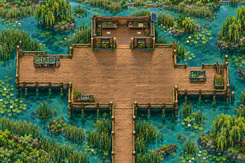

A floating research-lab setting with specimen tables and a continuous west-deck route.

**Configured in the files:** spatial layout (walkability untested), quiet-zone map property.

**Limits / defects:** Named areas are empty setup placeholders, not installed learning activities, simulations or services. No quest script is present.

Recovered original authoring and exact runtime.

[Full original-canvas preview](./previews/N28-r2-runtime.jpg) · [Exact source files, for review](https://github.com/BAWES-Universe/universe-maps/tree/9f80f9020df16993a4d1811552b0d816d403ccb1/archive/runtime-recovery-2026-10-13/N28-r2-runtime) · [Review / feedback](https://github.com/BAWES-Universe/universe-maps/blob/backup/map-source-recovery-2026-10-13/docs/map-testing/n-learning.md#n28)

**Import files:**
- [map32/map.tmj public file](https://bawes-universe.github.io/universe-maps/recovered/2026-10-13-collection-v1/N28-r2-runtime/map32/map.tmj) — SHA-256 `8f231bccc2586b64de3114badb497a8793cb874b99e925871cb9fcfd97d2cd31`
- [map32/map.wam public file](https://bawes-universe.github.io/universe-maps/recovered/2026-10-13-collection-v1/N28-r2-runtime/map32/map.wam) — SHA-256 `227df0263bb939f293bb0ee04a53929324a2197aa0f5d6da316820ff6eae9ea9`

**Test next:**
- Walk the entire west deck after clutter removal.
- Specimen-table feet and waterfront boundaries stay solid.

**Play room:** no verified room URL.

## Monastic Manuscript Scriptorium
**N29-r2 · Current candidate**

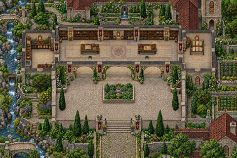

A manuscript/craft setting with an opened east workshop and retained equipment stations.

**Configured in the files:** spatial layout (walkability untested), quiet-zone map property.

**Limits / defects:** Named areas are empty setup placeholders, not installed learning activities, simulations or services. No quest script is present.

Recovered original authoring and exact runtime.

[Full original-canvas preview](./previews/N29-r2-runtime.jpg) · [Exact source files, for review](https://github.com/BAWES-Universe/universe-maps/tree/9f80f9020df16993a4d1811552b0d816d403ccb1/archive/runtime-recovery-2026-10-13/N29-r2-runtime) · [Review / feedback](https://github.com/BAWES-Universe/universe-maps/blob/backup/map-source-recovery-2026-10-13/docs/map-testing/n-learning.md#n29)

**Import files:**
- [map32/map.tmj public file](https://bawes-universe.github.io/universe-maps/recovered/2026-10-13-collection-v1/N29-r2-runtime/map32/map.tmj) — SHA-256 `bdcccf305cf5013b3d39ecec76b6841a7fb9f158ce976cd4705fb1f98e1bbdc9`
- [map32/map.wam public file](https://bawes-universe.github.io/universe-maps/recovered/2026-10-13-collection-v1/N29-r2-runtime/map32/map.wam) — SHA-256 `3dbf0229aa79162db1f742bf72ea513d907180d8fff18d4c365e39cb920b2370`

**Test next:**
- Enter and cross the opened east workshop where table/shelving were removed.
- Real remaining craft equipment stays protected; check native approaches.

**Play room:** no verified room URL.

## Glass Borough Civic Library
**N30-r2 · Current candidate**

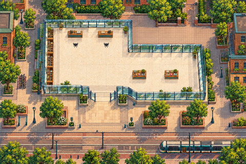

A civic-library setting with plaza crossings, trees, bicycles, lamps and protected fixture bases.

**Configured in the files:** spatial layout (walkability untested), quiet-zone map property.

**Limits / defects:** Named areas are empty setup placeholders, not installed learning activities, simulations or services. No quest script is present.

Recovered original authoring and exact runtime.

[Full original-canvas preview](./previews/N30-r2-runtime.jpg) · [Exact source files, for review](https://github.com/BAWES-Universe/universe-maps/tree/9f80f9020df16993a4d1811552b0d816d403ccb1/archive/runtime-recovery-2026-10-13/N30-r2-runtime) · [Review / feedback](https://github.com/BAWES-Universe/universe-maps/blob/backup/map-source-recovery-2026-10-13/docs/map-testing/n-learning.md#n30)

**Import files:**
- [map32/map.tmj public file](https://bawes-universe.github.io/universe-maps/recovered/2026-10-13-collection-v1/N30-r2-runtime/map32/map.tmj) — SHA-256 `aebb62f3fe5c86a19f3316662e6b664dff9e3aa9dc4aa03a2882cba275b85418`
- [map32/map.wam public file](https://bawes-universe.github.io/universe-maps/recovered/2026-10-13-collection-v1/N30-r2-runtime/map32/map.wam) — SHA-256 `d0274981ddc7d81d6d8fd4fb154ddee9cfac75323b7ca3c32ed177a9ab8eedd0`

**Test next:**
- Cross the plaza without stale invisible collision.
- Tree, bicycle, lamp and bollard bases remain solid.

**Play room:** no verified room URL.

## Desert Heliostat Research School
**N31-r2 · Current candidate**

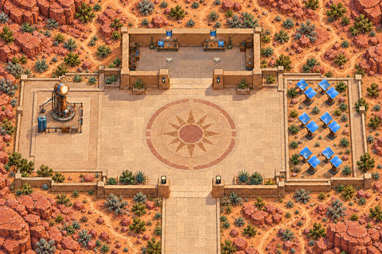

A solar-research classroom with study chairs, equipment and a bounded terrace.

**Configured in the files:** spatial layout (walkability untested), quiet-zone map property.

**Limits / defects:** Named areas are empty setup placeholders, not installed learning activities, simulations or services. No quest script is present.

Recovered original authoring and exact runtime.

[Full original-canvas preview](./previews/N31-r2-runtime.jpg) · [Exact source files, for review](https://github.com/BAWES-Universe/universe-maps/tree/9f80f9020df16993a4d1811552b0d816d403ccb1/archive/runtime-recovery-2026-10-13/N31-r2-runtime) · [Review / feedback](https://github.com/BAWES-Universe/universe-maps/blob/backup/map-source-recovery-2026-10-13/docs/map-testing/n-learning.md#n31)

**Import files:**
- [map32/map.tmj public file](https://bawes-universe.github.io/universe-maps/recovered/2026-10-13-collection-v1/N31-r2-runtime/map32/map.tmj) — SHA-256 `eb39681b735811862b75a7235d06a1d6ab5b96996d0dd7041a3c3614e289b020`
- [map32/map.wam public file](https://bawes-universe.github.io/universe-maps/recovered/2026-10-13-collection-v1/N31-r2-runtime/map32/map.wam) — SHA-256 `ff5ed7cb61c3af95f39371b84b7856bf10a0f350121ba7e1c045439446ca9e7b`

**Test next:**
- Test study-chair arrivals and the classroom doorway with the native player.
- Equipment and terrace boundaries remain protected while circulation stays connected.

**Play room:** no verified room URL.

## Indigo Textile Design Guild
**N32-r2 · Current candidate**

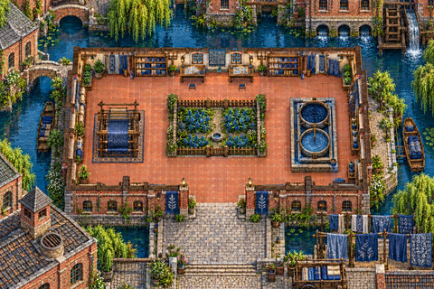

A textile workshop and court with a visibly closed garden gate and protected pots/walls.

**Configured in the files:** spatial layout (walkability untested), quiet-zone map property.

**Limits / defects:** Named areas are empty setup placeholders, not installed learning activities, simulations or services. No quest script is present.

Recovered original authoring and exact runtime.

[Full original-canvas preview](./previews/N32-r2-runtime.jpg) · [Exact source files, for review](https://github.com/BAWES-Universe/universe-maps/tree/9f80f9020df16993a4d1811552b0d816d403ccb1/archive/runtime-recovery-2026-10-13/N32-r2-runtime) · [Review / feedback](https://github.com/BAWES-Universe/universe-maps/blob/backup/map-source-recovery-2026-10-13/docs/map-testing/n-learning.md#n32)

**Import files:**
- [map32/map.tmj public file](https://bawes-universe.github.io/universe-maps/recovered/2026-10-13-collection-v1/N32-r2-runtime/map32/map.tmj) — SHA-256 `c851ef2a17bcee3a0be9059c590d3b5849eb8a4fe663d18d661516470a1666cc`
- [map32/map.wam public file](https://bawes-universe.github.io/universe-maps/recovered/2026-10-13-collection-v1/N32-r2-runtime/map32/map.wam) — SHA-256 `f0a80baee4b52ee63390dd46c3aeaf75afd2be2e33690bd2c9f471e803245b41`

**Test next:**
- Use workshop/court routes and approach the visibly closed garden gate.
- Three pot bases and west court wall remain solid; the closed gate must not become an invisible passage.

**Play room:** no verified room URL.

## Circular Civic Debate Hall
**N33-r1 · Current candidate**

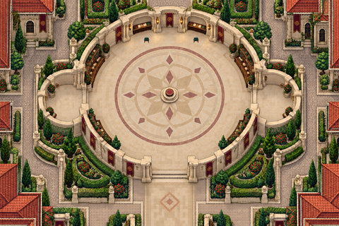

A circular debate forum with clerk chairs, a lectern, shelving and a cleared exterior court.

**Configured in the files:** spatial layout (walkability untested), quiet-zone map property.

**Limits / defects:** Named areas are empty setup placeholders, not installed learning activities, simulations or services. No quest script is present.

Recovered original authoring and exact runtime.

[Full original-canvas preview](./previews/N33-r1-runtime.jpg) · [Exact source files, for review](https://github.com/BAWES-Universe/universe-maps/tree/9f80f9020df16993a4d1811552b0d816d403ccb1/archive/runtime-recovery-2026-10-13/N33-r1-runtime) · [Review / feedback](https://github.com/BAWES-Universe/universe-maps/blob/backup/map-source-recovery-2026-10-13/docs/map-testing/n-learning.md#n33)

**Import files:**
- [map32/map.tmj public file](https://bawes-universe.github.io/universe-maps/recovered/2026-10-13-collection-v1/N33-r1-runtime/map32/map.tmj) — SHA-256 `1a280d1b17e398f30a1bccbf91d6fb880c6d91124022df39354561dd589aee37`
- [map32/map.wam public file](https://bawes-universe.github.io/universe-maps/recovered/2026-10-13-collection-v1/N33-r1-runtime/map32/map.wam) — SHA-256 `9d58a2c1cd247c0c3b4dc077879dcb07dd281fa25a32ebffa19f5ddbfe30126d`

**Test next:**
- Reach clerk chairs and traverse the complete forum.
- Real lectern, shelving and planter bases stay solid; removed exterior clutter leaves usable paving.

**Play room:** no verified room URL.

## Harbour Language Exchange Lab
**N34-r2 · Current candidate**

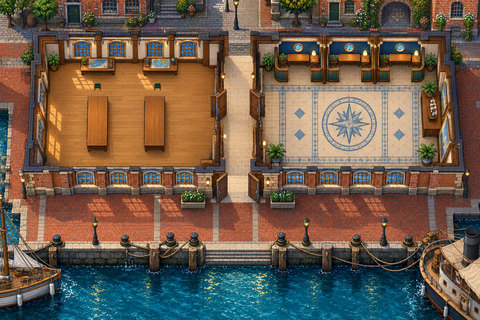

A waterfront language-learning layout with two classrooms, conversation pods and quay branches.

**Configured in the files:** spatial layout (walkability untested), quiet-zone map property.

**Limits / defects:** Named areas are empty setup placeholders, not installed learning activities, simulations or services. No quest script is present.

Recovered original authoring and exact runtime.

[Full original-canvas preview](./previews/N34-r2-runtime.jpg) · [Exact source files, for review](https://github.com/BAWES-Universe/universe-maps/tree/9f80f9020df16993a4d1811552b0d816d403ccb1/archive/runtime-recovery-2026-10-13/N34-r2-runtime) · [Review / feedback](https://github.com/BAWES-Universe/universe-maps/blob/backup/map-source-recovery-2026-10-13/docs/map-testing/n-learning.md#n34)

**Import files:**
- [map32/map.tmj public file](https://bawes-universe.github.io/universe-maps/recovered/2026-10-13-collection-v1/N34-r2-runtime/map32/map.tmj) — SHA-256 `2273fef40efbcc3c323305067bc32e1c832fb307c32d058470d36444ec699bcc`
- [map32/map.wam public file](https://bawes-universe.github.io/universe-maps/recovered/2026-10-13-collection-v1/N34-r2-runtime/map32/map.wam) — SHA-256 `43cc4ef20ac886fc5fa1635ed6787fb5cd60ac95d27c29c2a8a7f63133ebebef`

**Test next:**
- Visit both classrooms, all pods and each waterfront branch.
- Desk/divider/quay bases including the north lamp remain solid.

**Play room:** no verified room URL.

