# Social & leisure

[← Whole collection](../../COLLECTION.md)

N01–N17: distinct social settings. Their names describe spaces, not supplied arcade, film or game services.

**File links below are public import targets, not play rooms.** The original runtime backup is verified; publication checks and live acceptance are separate. Static previews are reconstructed from original TMJ / image bytes; no new art.

## Ember Ridge Lodge
**N01-r3 · Current candidate**

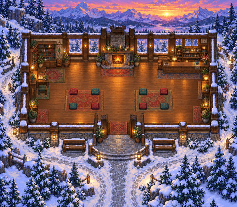

A lodge landscape with open routes to cushion seating, designed for informal social gathering.

**Configured in the files:** spatial layout (walkability untested), quiet-zone map property.

**Limits / defects:** No custom gameplay script or dedicated activity/service is supplied; titles such as Arcade or Film Society do not establish playable games or media services.

Recovered original authoring and exact runtime.

[Full original-canvas preview](./previews/N01-r3-runtime.jpg) · [Exact source files, for review](https://github.com/BAWES-Universe/universe-maps/tree/9f80f9020df16993a4d1811552b0d816d403ccb1/archive/runtime-recovery-2026-10-13/N01-r3-runtime) · [Review / feedback](https://github.com/BAWES-Universe/universe-maps/blob/backup/map-source-recovery-2026-10-13/docs/map-testing/n-social.md#n01)

**Import files:**
- [N01.tmj public file](https://bawes-universe.github.io/universe-maps/recovered/2026-10-13-collection-v1/N01-r3-runtime/N01.tmj) — SHA-256 `d8e48cbd12be7d3b132440e16bf5ea4e849b9e457f1d24457b302570887f2ecb`
- [N01.wam public file](https://bawes-universe.github.io/universe-maps/recovered/2026-10-13-collection-v1/N01-r3-runtime/N01.wam) — SHA-256 `49984f484728ef3882fb8b25bb53fd0193eacb716582418a3c2f757ddb78a609`

**Test next:**
- Open lodge/cushion access after central-table removal; check the formerly boxed-in layout remains connected.
- Test cushion arrivals from both sides without stepping into remaining furniture.

**Play room:** no verified room URL.

## Lantern Dune Majlis
**N02-r4 · Current candidate**

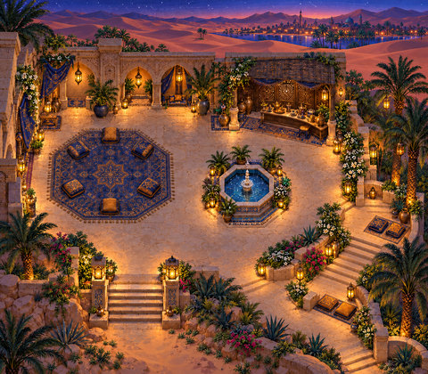

A desert majlis with ten cushion positions and a garden reached by a broad staircase.

**Configured in the files:** spatial layout (walkability untested), quiet-zone map property.

**Limits / defects:** No custom gameplay script or dedicated activity/service is supplied; titles such as Arcade or Film Society do not establish playable games or media services.

Recovered original authoring and exact runtime.

[Full original-canvas preview](./previews/N02-r4-runtime.jpg) · [Exact source files, for review](https://github.com/BAWES-Universe/universe-maps/tree/9f80f9020df16993a4d1811552b0d816d403ccb1/archive/runtime-recovery-2026-10-13/N02-r4-runtime) · [Review / feedback](https://github.com/BAWES-Universe/universe-maps/blob/backup/map-source-recovery-2026-10-13/docs/map-testing/n-social.md#n02)

**Import files:**
- [N02.tmj public file](https://bawes-universe.github.io/universe-maps/recovered/2026-10-13-collection-v1/N02-r4-runtime/N02.tmj) — SHA-256 `1c79d398577a164cd56d654db9c3e5085e329b07980c27b15f8d91c71c870cd3`
- [N02.wam public file](https://bawes-universe.github.io/universe-maps/recovered/2026-10-13-collection-v1/N02-r4-runtime/N02.wam) — SHA-256 `c648a716c1051c6949d225a4a8a972ac2329b9bf5b33123518b12025117a1a9a`

**Test next:**
- Use the broad garden stair, never a shortcut through its retaining wall.
- Try all ten cushion arrivals and keep wall/rail edges solid.

**Play room:** no verified room URL.

## Clay Circle Atelier
**N03-r3 · Current candidate**

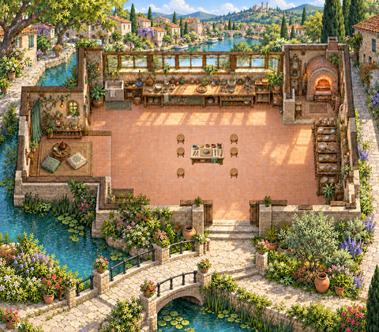

A clay-and-craft atelier with six stool positions and a stone bridge between its social spaces.

**Configured in the files:** spatial layout (walkability untested), quiet-zone map property.

**Limits / defects:** No custom gameplay script or dedicated activity/service is supplied; titles such as Arcade or Film Society do not establish playable games or media services.

Recovered original authoring and exact runtime.

[Full original-canvas preview](./previews/N03-r3-runtime.jpg) · [Exact source files, for review](https://github.com/BAWES-Universe/universe-maps/tree/9f80f9020df16993a4d1811552b0d816d403ccb1/archive/runtime-recovery-2026-10-13/N03-r3-runtime) · [Review / feedback](https://github.com/BAWES-Universe/universe-maps/blob/backup/map-source-recovery-2026-10-13/docs/map-testing/n-social.md#n03)

**Import files:**
- [N03.tmj public file](https://bawes-universe.github.io/universe-maps/recovered/2026-10-13-collection-v1/N03-r3-runtime/N03.tmj) — SHA-256 `7b1b47582da94e22c9bf0fc30926a92ff75e41795afbf6c9896e791a519c2926`
- [N03.wam public file](https://bawes-universe.github.io/universe-maps/recovered/2026-10-13-collection-v1/N03-r3-runtime/N03.wam) — SHA-256 `b5614d747545417712a5d6383ac886693765e3beb1bd3a09a0d53e64051d3f5d`

**Test next:**
- Try all six stool arrivals and inspect their seat/body alignment.
- Cross the stone bridge on its deck; parapets must block passage.

**Play room:** no verified room URL.

## Glassleaf Cooking Club
**N04-r3 · Current candidate**

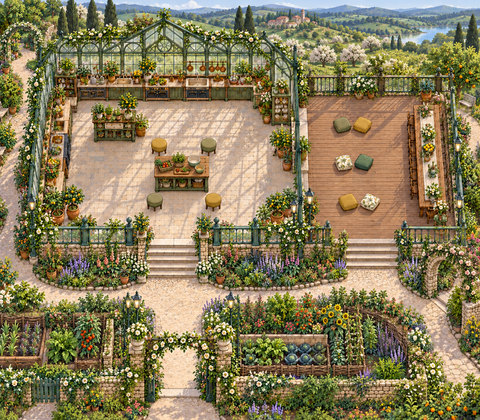

A cooking-club setting with prep stools, terrace cushions and a floral entrance gateway.

**Configured in the files:** spatial layout (walkability untested), quiet-zone map property.

**Limits / defects:** No custom gameplay script or dedicated activity/service is supplied; titles such as Arcade or Film Society do not establish playable games or media services.

Recovered original authoring and exact runtime.

[Full original-canvas preview](./previews/N04-r3-runtime.jpg) · [Exact source files, for review](https://github.com/BAWES-Universe/universe-maps/tree/9f80f9020df16993a4d1811552b0d816d403ccb1/archive/runtime-recovery-2026-10-13/N04-r3-runtime) · [Review / feedback](https://github.com/BAWES-Universe/universe-maps/blob/backup/map-source-recovery-2026-10-13/docs/map-testing/n-social.md#n04)

**Import files:**
- [N04.tmj public file](https://bawes-universe.github.io/universe-maps/recovered/2026-10-13-collection-v1/N04-r3-runtime/N04.tmj) — SHA-256 `0025d9d724ca462206ab2a747624e650d29bb52b0619c6726ad56fd5125f0efa`
- [N04.wam public file](https://bawes-universe.github.io/universe-maps/recovered/2026-10-13-collection-v1/N04-r3-runtime/N04.wam) — SHA-256 `7c7021601fbcf32f1156396dc9a711f650e57f95d060ca72faa5aae9dccc47ef`

**Test next:**
- Walk under the floral gateway and check foreground depth with the player head visible.
- Try four prep stools and six terrace cushions from both directions.

**Play room:** no verified room URL.

## Dicewood Table Club
**N05-r3 · Current candidate**

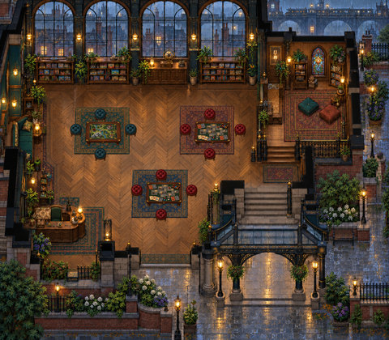

A tabletop-club setting with three table stations, stools and a glass canopy.

**Configured in the files:** spatial layout (walkability untested), quiet-zone map property.

**Limits / defects:** No custom gameplay script or dedicated activity/service is supplied; titles such as Arcade or Film Society do not establish playable games or media services.

Recovered original authoring and exact runtime.

[Full original-canvas preview](./previews/N05-r3-runtime.jpg) · [Exact source files, for review](https://github.com/BAWES-Universe/universe-maps/tree/9f80f9020df16993a4d1811552b0d816d403ccb1/archive/runtime-recovery-2026-10-13/N05-r3-runtime) · [Review / feedback](https://github.com/BAWES-Universe/universe-maps/blob/backup/map-source-recovery-2026-10-13/docs/map-testing/n-social.md#n05)

**Import files:**
- [N05.tmj public file](https://bawes-universe.github.io/universe-maps/recovered/2026-10-13-collection-v1/N05-r3-runtime/N05.tmj) — SHA-256 `6b7efb35e468f60a38e024889171415930b2c7d77bde925e9f38c12bdb2e12c1`
- [N05.wam public file](https://bawes-universe.github.io/universe-maps/recovered/2026-10-13-collection-v1/N05-r3-runtime/N05.wam) — SHA-256 `3900177a0f33474eac835950ff777a31ee3bb3ac01c60c7872f04bc10335f46a`

**Test next:**
- Reach all three tabletop stations with exact stool placement.
- Keep table bodies solid and player visibility correct under the glass canopy.

**Play room:** no verified room URL.

## Copperbeat Rehearsal
**N06-r2 · Current candidate**

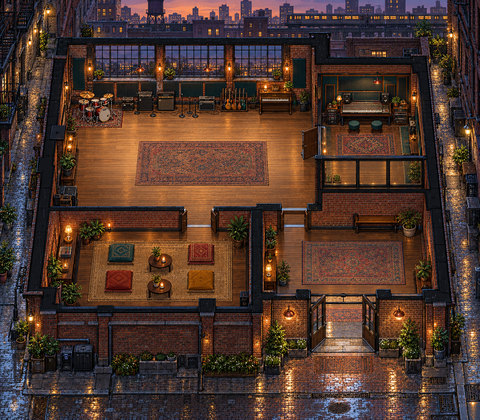

A rehearsal floor connected to a glazed control booth, lounge and side alleys.

**Configured in the files:** spatial layout (walkability untested), quiet-zone map property.

**Limits / defects:** No custom gameplay script or dedicated activity/service is supplied; titles such as Arcade or Film Society do not establish playable games or media services.

Recovered original authoring and exact runtime.

[Full original-canvas preview](./previews/N06-r2-runtime.jpg) · [Exact source files, for review](https://github.com/BAWES-Universe/universe-maps/tree/9f80f9020df16993a4d1811552b0d816d403ccb1/archive/runtime-recovery-2026-10-13/N06-r2-runtime) · [Review / feedback](https://github.com/BAWES-Universe/universe-maps/blob/backup/map-source-recovery-2026-10-13/docs/map-testing/n-social.md#n06)

**Import files:**
- [N06.tmj public file](https://bawes-universe.github.io/universe-maps/recovered/2026-10-13-collection-v1/N06-r2-runtime/N06.tmj) — SHA-256 `d2fa2106ebd9a6f23b58c5e750f2a2beaafa2e21fea668617fd35a86b1b64622`
- [N06.wam public file](https://bawes-universe.github.io/universe-maps/recovered/2026-10-13-collection-v1/N06-r2-runtime/N06.wam) — SHA-256 `40b1a218d58e18553d46aaa54591365ed9e9cf260ab4e5044e9f5891428c4276`

**Test next:**
- Walk from rehearsal floor to control booth, lounge and both side alleys.
- Check booth-glass visibility and rehearsal/media behavior with another user if configured.

**Play room:** no verified room URL.

## Harbor Tongues Exchange
**N07-r3 · Current candidate**

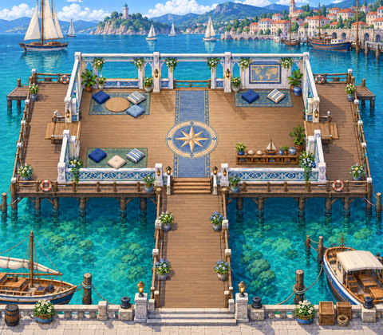

A waterfront language-exchange setting with side decks reached through actual doorways.

**Configured in the files:** spatial layout (walkability untested), quiet-zone map property.

**Limits / defects:** No custom gameplay script or dedicated activity/service is supplied; titles such as Arcade or Film Society do not establish playable games or media services.

Recovered original authoring and exact runtime.

[Full original-canvas preview](./previews/N07-r3-runtime.jpg) · [Exact source files, for review](https://github.com/BAWES-Universe/universe-maps/tree/9f80f9020df16993a4d1811552b0d816d403ccb1/archive/runtime-recovery-2026-10-13/N07-r3-runtime) · [Review / feedback](https://github.com/BAWES-Universe/universe-maps/blob/backup/map-source-recovery-2026-10-13/docs/map-testing/n-social.md#n07)

**Import files:**
- [N07.tmj public file](https://bawes-universe.github.io/universe-maps/recovered/2026-10-13-collection-v1/N07-r3-runtime/N07.tmj) — SHA-256 `b96f56cc179b53ee4cb69cb93f8f314fbeba4be5cf2bbaf6a9b1f1a68cc2d48d`
- [N07.wam public file](https://bawes-universe.github.io/universe-maps/recovered/2026-10-13-collection-v1/N07-r3-runtime/N07.wam) — SHA-256 `df947bda73e351310c1f83f1b06e26d3484bf406997859b43ebce1cf7c20c533`

**Test next:**
- Reach both side decks through real doorways.
- Check south-rail transparency keeps the player readable while the railing footprint stays solid.

**Play room:** no verified room URL.

## Mosswater Tea House
**N08-r3 · Current candidate**

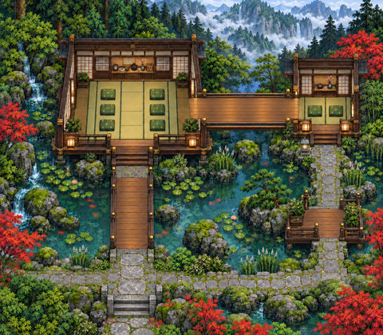

Two tea pavilions connected by a wide cedar bridge and garden path.

**Configured in the files:** spatial layout (walkability untested), quiet-zone map property.

**Limits / defects:** No custom gameplay script or dedicated activity/service is supplied; titles such as Arcade or Film Society do not establish playable games or media services.

Recovered original authoring and exact runtime.

[Full original-canvas preview](./previews/N08-r3-runtime.jpg) · [Exact source files, for review](https://github.com/BAWES-Universe/universe-maps/tree/9f80f9020df16993a4d1811552b0d816d403ccb1/archive/runtime-recovery-2026-10-13/N08-r3-runtime) · [Review / feedback](https://github.com/BAWES-Universe/universe-maps/blob/backup/map-source-recovery-2026-10-13/docs/map-testing/n-social.md#n08)

**Import files:**
- [N08.tmj public file](https://bawes-universe.github.io/universe-maps/recovered/2026-10-13-collection-v1/N08-r3-runtime/N08.tmj) — SHA-256 `5d724f1cd9426c4767d3ecd6d80b2626335e2a5b0512108cc9de1423b72dc530`
- [N08.wam public file](https://bawes-universe.github.io/universe-maps/recovered/2026-10-13-collection-v1/N08-r3-runtime/N08.wam) — SHA-256 `2f9ebfee802ab5297691faf5f9b4ef42716206e3edc0e2315b24bb4bb0558d59`

**Test next:**
- Cross the widened cedar bridge end to end.
- Reach both tea pavilions and the full garden path; inspect bank/rail collision.

**Play room:** no verified room URL.

## Turntable Dance Loft
**N09-r2 · Current candidate**

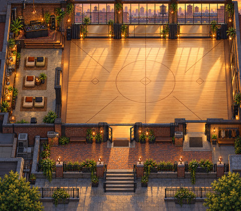

An open dance floor with five lounge-chair positions and a separate DJ approach.

**Configured in the files:** spatial layout (walkability untested), quiet-zone map property.

**Limits / defects:** No custom gameplay script or dedicated activity/service is supplied; titles such as Arcade or Film Society do not establish playable games or media services.

Recovered original authoring and exact runtime.

[Full original-canvas preview](./previews/N09-r2-runtime.jpg) · [Exact source files, for review](https://github.com/BAWES-Universe/universe-maps/tree/9f80f9020df16993a4d1811552b0d816d403ccb1/archive/runtime-recovery-2026-10-13/N09-r2-runtime) · [Review / feedback](https://github.com/BAWES-Universe/universe-maps/blob/backup/map-source-recovery-2026-10-13/docs/map-testing/n-social.md#n09)

**Import files:**
- [N09.tmj public file](https://bawes-universe.github.io/universe-maps/recovered/2026-10-13-collection-v1/N09-r2-runtime/N09.tmj) — SHA-256 `e84da61edec377e85d0e463defa9c41b703a404e4d8782ed5d83932dae60f3c1`
- [N09.wam public file](https://bawes-universe.github.io/universe-maps/recovered/2026-10-13-collection-v1/N09-r2-runtime/N09.wam) — SHA-256 `9088aa89bf8d56ed7f867764adb5dacf1f9779bdc99272a6b6061a1f976e6e25`

**Test next:**
- Cross the dance floor and all doorways, then approach the DJ area separately.
- Test all five lounge-chair arrivals and inspect native player fit.

**Play room:** no verified room URL.

## Silvergrain Photo Club
**N10-r4 · Current candidate**

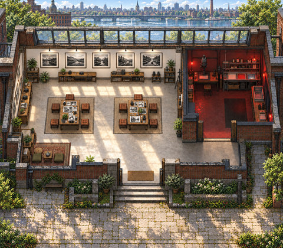

A photography-club setting with a photo wall, benches, a west nook and a stone forecourt.

**Configured in the files:** spatial layout (walkability untested), quiet-zone map property.

**Limits / defects:** No custom gameplay script or dedicated activity/service is supplied; titles such as Arcade or Film Society do not establish playable games or media services.

Recovered original authoring and exact runtime.

[Full original-canvas preview](./previews/N10-r4-runtime.jpg) · [Exact source files, for review](https://github.com/BAWES-Universe/universe-maps/tree/9f80f9020df16993a4d1811552b0d816d403ccb1/archive/runtime-recovery-2026-10-13/N10-r4-runtime) · [Review / feedback](https://github.com/BAWES-Universe/universe-maps/blob/backup/map-source-recovery-2026-10-13/docs/map-testing/n-social.md#n10)

**Import files:**
- [N10.tmj public file](https://bawes-universe.github.io/universe-maps/recovered/2026-10-13-collection-v1/N10-r4-runtime/N10.tmj) — SHA-256 `77601ced44d304a9f38171edad2a2c76f39b8a91516aec37bb614dd787abac69`
- [N10.wam public file](https://bawes-universe.github.io/universe-maps/recovered/2026-10-13-collection-v1/N10-r4-runtime/N10.wam) — SHA-256 `326def4fc2b1552d493c0f295b38a2219d24191f10ce418d04d951e15637d8b8`

**Test next:**
- Walk the broad west-nook route and connected stone forecourt.
- Photo wall and bench bodies must stay solid; inspect arrival/readability around them.

**Play room:** no verified room URL.

## Framehouse Film Society
**N11-r2 · Current candidate**

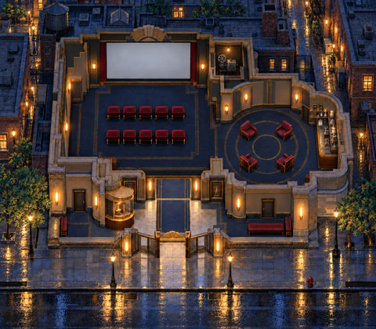

A screening-room layout with velvet poufs and aisles, plus a discussion salon, lobby and street.

**Configured in the files:** spatial layout (walkability untested), quiet-zone map property.

**Limits / defects:** No custom gameplay script or dedicated activity/service is supplied; titles such as Arcade or Film Society do not establish playable games or media services.

Recovered original authoring and exact runtime.

[Full original-canvas preview](./previews/N11-r2-runtime.jpg) · [Exact source files, for review](https://github.com/BAWES-Universe/universe-maps/tree/9f80f9020df16993a4d1811552b0d816d403ccb1/archive/runtime-recovery-2026-10-13/N11-r2-runtime) · [Review / feedback](https://github.com/BAWES-Universe/universe-maps/blob/backup/map-source-recovery-2026-10-13/docs/map-testing/n-social.md#n11)

**Import files:**
- [N11.tmj public file](https://bawes-universe.github.io/universe-maps/recovered/2026-10-13-collection-v1/N11-r2-runtime/N11.tmj) — SHA-256 `b6dd7464df666cad01c6b31de87232cef81290061ca5442898ad34578601e903`
- [N11.wam public file](https://bawes-universe.github.io/universe-maps/recovered/2026-10-13-collection-v1/N11-r2-runtime/N11.wam) — SHA-256 `9f2b3bbc92ac32a95e3ed17423abf0949fae858fdf6f28c0580f67ee22978f98`

**Test next:**
- Walk all screening aisles and the separate salon, lobby and street routes.
- Try velvet pouf approaches and screening audio/media with two users if configured.

**Play room:** no verified room URL.

## Tideglass Aquarium Hall
**N12-r3 · Current candidate**

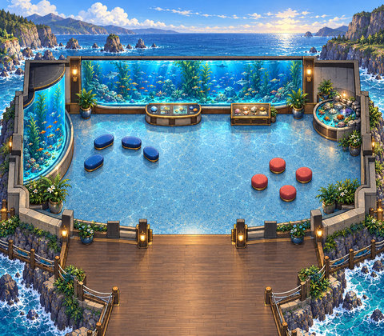

An aquarium hall with display tanks, a central entrance and two connected deck branches.

**Configured in the files:** spatial layout (walkability untested), quiet-zone map property.

**Limits / defects:** No custom gameplay script or dedicated activity/service is supplied; titles such as Arcade or Film Society do not establish playable games or media services.

Recovered original authoring and exact runtime.

[Full original-canvas preview](./previews/N12-r3-runtime.jpg) · [Exact source files, for review](https://github.com/BAWES-Universe/universe-maps/tree/9f80f9020df16993a4d1811552b0d816d403ccb1/archive/runtime-recovery-2026-10-13/N12-r3-runtime) · [Review / feedback](https://github.com/BAWES-Universe/universe-maps/blob/backup/map-source-recovery-2026-10-13/docs/map-testing/n-social.md#n12)

**Import files:**
- [N12.tmj public file](https://bawes-universe.github.io/universe-maps/recovered/2026-10-13-collection-v1/N12-r3-runtime/N12.tmj) — SHA-256 `33717693e09a13cfe3f1f72097be5ffebca1782af5ee09da2e8b2ca0823fe726`
- [N12.wam public file](https://bawes-universe.github.io/universe-maps/recovered/2026-10-13-collection-v1/N12-r3-runtime/N12.wam) — SHA-256 `724ef6025b304102f27f9c7a44eade7bafdbfe45df1275231aa893c76e08afc3`

**Test next:**
- Traverse the central entrance and both deck branches with full body width.
- Entrance posts, pots and tank bases must remain solid.

**Play room:** no verified room URL.

## Snowsteam Bathhouse
**N13-r3 · Current candidate**

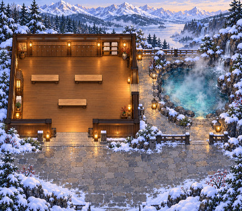

A bathhouse setting with a forecourt and a narrow route beside the pool, rocks and lanterns.

**Configured in the files:** spatial layout (walkability untested), quiet-zone map property.

**Limits / defects:** No custom gameplay script or dedicated activity/service is supplied; titles such as Arcade or Film Society do not establish playable games or media services.

Recovered original authoring and exact runtime.

[Full original-canvas preview](./previews/N13-r3-runtime.jpg) · [Exact source files, for review](https://github.com/BAWES-Universe/universe-maps/tree/9f80f9020df16993a4d1811552b0d816d403ccb1/archive/runtime-recovery-2026-10-13/N13-r3-runtime) · [Review / feedback](https://github.com/BAWES-Universe/universe-maps/blob/backup/map-source-recovery-2026-10-13/docs/map-testing/n-social.md#n13)

**Import files:**
- [N13.tmj public file](https://bawes-universe.github.io/universe-maps/recovered/2026-10-13-collection-v1/N13-r3-runtime/N13.tmj) — SHA-256 `127187d48e062b9b76798dc8cfa97eea47a3cb1f5b8ab6588ec4886d36cc5a95`
- [N13.wam public file](https://bawes-universe.github.io/universe-maps/recovered/2026-10-13-collection-v1/N13-r3-runtime/N13.wam) — SHA-256 `d3e37cc449c884b48935861b4542d88e4a623ba8a099e48b7bce5eb190397513`

**Test next:**
- Walk from forecourt through the room and narrow pool-side route.
- Keep pool, rock and lantern bases solid; inspect foreground depth near water.

**Play room:** no verified room URL.

## Skylot Garden Commons
**N14-r2 · Current candidate**

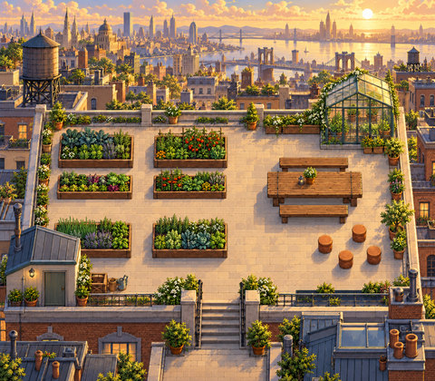

A garden commons with picnic furniture and an open cross-aisle between planting beds.

**Configured in the files:** spatial layout (walkability untested), quiet-zone map property.

**Limits / defects:** No custom gameplay script or dedicated activity/service is supplied; titles such as Arcade or Film Society do not establish playable games or media services.

Recovered original authoring and exact runtime.

[Full original-canvas preview](./previews/N14-r2-runtime.jpg) · [Exact source files, for review](https://github.com/BAWES-Universe/universe-maps/tree/9f80f9020df16993a4d1811552b0d816d403ccb1/archive/runtime-recovery-2026-10-13/N14-r2-runtime) · [Review / feedback](https://github.com/BAWES-Universe/universe-maps/blob/backup/map-source-recovery-2026-10-13/docs/map-testing/n-social.md#n14)

**Import files:**
- [N14.tmj public file](https://bawes-universe.github.io/universe-maps/recovered/2026-10-13-collection-v1/N14-r2-runtime/N14.tmj) — SHA-256 `b0f95412c279e45a7dbcd8c3c381260c0787bd0b0d2d96f775192c8573d22a85`
- [N14.wam public file](https://bawes-universe.github.io/universe-maps/recovered/2026-10-13-collection-v1/N14-r2-runtime/N14.wam) — SHA-256 `3fd8b6319681966b46b06ed361f6f9bf3a9752907d6acb38809f775ae4a6384d`

**Test next:**
- Use the real cross-aisle between shortened planting beds.
- Keep picnic furniture and garden fixtures solid without blocking clear paving.

**Play room:** no verified room URL.

## Threadwell Craft Studio
**N15-r3 · Current candidate**

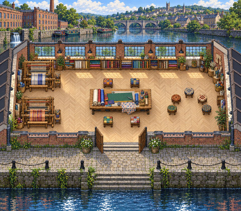

A textile craft studio with loom gaps, cutting-table approaches and canal steps.

**Configured in the files:** spatial layout (walkability untested), quiet-zone map property.

**Limits / defects:** No custom gameplay script or dedicated activity/service is supplied; titles such as Arcade or Film Society do not establish playable games or media services.

Recovered original authoring and exact runtime.

[Full original-canvas preview](./previews/N15-r3-runtime.jpg) · [Exact source files, for review](https://github.com/BAWES-Universe/universe-maps/tree/9f80f9020df16993a4d1811552b0d816d403ccb1/archive/runtime-recovery-2026-10-13/N15-r3-runtime) · [Review / feedback](https://github.com/BAWES-Universe/universe-maps/blob/backup/map-source-recovery-2026-10-13/docs/map-testing/n-social.md#n15)

**Import files:**
- [N15.tmj public file](https://bawes-universe.github.io/universe-maps/recovered/2026-10-13-collection-v1/N15-r3-runtime/N15.tmj) — SHA-256 `ce51c72174c0cebaf87a7c373b75936a155d809b79c0837aedcc0e5391f871a7`
- [N15.wam public file](https://bawes-universe.github.io/universe-maps/recovered/2026-10-13-collection-v1/N15-r3-runtime/N15.wam) — SHA-256 `2ae2624a52ca6d4fee7a4df19b2c72c20517b9a14e6b2bf32ff176724288d109`

**Test next:**
- Traverse canal steps, loom gaps and cutting-table approaches.
- The stair post and real equipment must stay solid without narrowing the walkway.

**Play room:** no verified room URL.

## Rainveil Meditation
**N16-r2 · Current candidate**

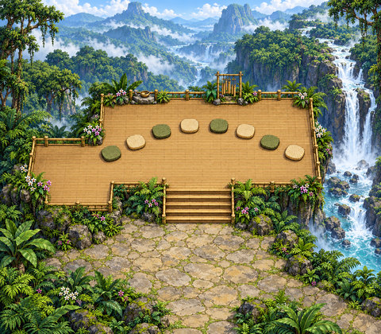

A meditation setting with a broad main staircase and an L-shaped west platform.

**Configured in the files:** spatial layout (walkability untested), quiet-zone map property.

**Limits / defects:** No custom gameplay script or dedicated activity/service is supplied; titles such as Arcade or Film Society do not establish playable games or media services.

Recovered original authoring and exact runtime.

[Full original-canvas preview](./previews/N16-r2-runtime.jpg) · [Exact source files, for review](https://github.com/BAWES-Universe/universe-maps/tree/9f80f9020df16993a4d1811552b0d816d403ccb1/archive/runtime-recovery-2026-10-13/N16-r2-runtime) · [Review / feedback](https://github.com/BAWES-Universe/universe-maps/blob/backup/map-source-recovery-2026-10-13/docs/map-testing/n-social.md#n16)

**Import files:**
- [N16.tmj public file](https://bawes-universe.github.io/universe-maps/recovered/2026-10-13-collection-v1/N16-r2-runtime/N16.tmj) — SHA-256 `2946e076ced81d0735136ee14b1d63ee4a0e26a12ea8eaa4235f610427ace79f`
- [N16.wam public file](https://bawes-universe.github.io/universe-maps/recovered/2026-10-13-collection-v1/N16-r2-runtime/N16.wam) — SHA-256 `a21a85d3d4a784eadbf60fdd657040a298badae7b627527dc912251d05d40db4`

**Test next:**
- Use the broad main stair and complete L-shaped west platform.
- South rails and both stair-end posts must remain solid.

**Play room:** no verified room URL.

## Neon Nickel Arcade
**N17-r3 · Current candidate**

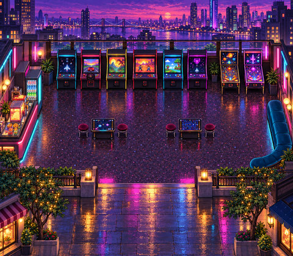

An arcade-themed hall with machines, cocktail-table aisles and a branching forecourt.

**Configured in the files:** spatial layout (walkability untested), quiet-zone map property.

**Limits / defects:** No custom gameplay script or dedicated activity/service is supplied; titles such as Arcade or Film Society do not establish playable games or media services.

Recovered original authoring and exact runtime.

[Full original-canvas preview](./previews/N17-r3-runtime.jpg) · [Exact source files, for review](https://github.com/BAWES-Universe/universe-maps/tree/9f80f9020df16993a4d1811552b0d816d403ccb1/archive/runtime-recovery-2026-10-13/N17-r3-runtime) · [Review / feedback](https://github.com/BAWES-Universe/universe-maps/blob/backup/map-source-recovery-2026-10-13/docs/map-testing/n-social.md#n17)

**Import files:**
- [N17.tmj public file](https://bawes-universe.github.io/universe-maps/recovered/2026-10-13-collection-v1/N17-r3-runtime/N17.tmj) — SHA-256 `d2ab2a301b630810f0097c0bb70eb8e3c14942cb8067fc071855fa383b4e7d3c`
- [N17.wam public file](https://bawes-universe.github.io/universe-maps/recovered/2026-10-13-collection-v1/N17-r3-runtime/N17.wam) — SHA-256 `b87e9e9cd530d9b5b8f6805ec337138d918f30cc14be0a1d4db27647d79f7596`

**Test next:**
- Try cocktail-table aisles, open hall and both forecourt branches.
- Machines, counters and furniture bodies must stay solid; only claim arcade interaction if configured.

**Play room:** no verified room URL.

