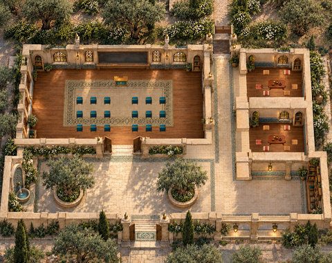
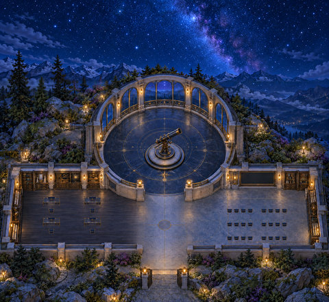
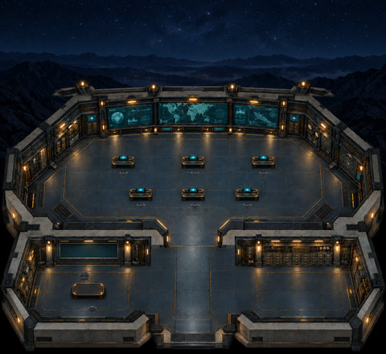
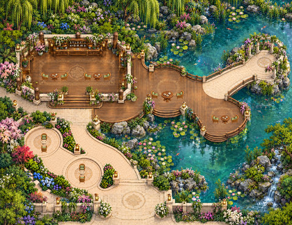
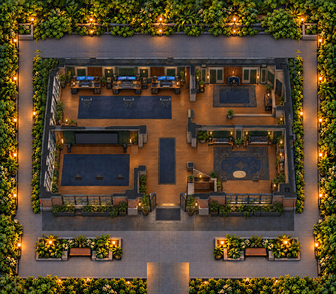
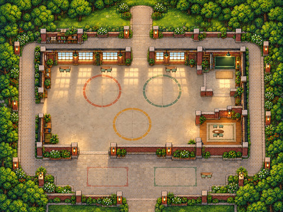
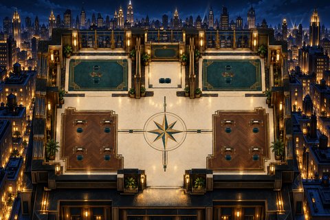
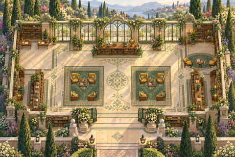

# Shared spaces

[← Whole collection](../../COLLECTION.md)

Ten standalone shared-space candidates. The older archived Workshop, Souk and Academy revisions stay distinct from their newer hosted repairs.

**File links below are public import targets, not play rooms.** The original runtime backup is verified; publication checks and live acceptance are separate. Static previews are reconstructed from original TMJ / image bytes; no new art.

## Olive Arabic Academy r6
**olive-academy-live-repair-r6 · Current candidate**

A teaching room and woven lounges; the companion WAM defines a teacher megaphone, classroom listeners and two conversation lounges.

**Configured in the files:** spatial layout (walkability untested), quiet-zone map property, WAM speaker/audience definitions, WAM meeting-room definitions.

**Limits / defects:** Configured definitions are not live service acceptance. Hosted-file candidate; live acceptance open

Preserved surviving runtime, unchanged. The review record distinguishes retained authoring, historical variants and incomplete master-source recovery.

[Full original-canvas preview](./previews/olive-academy-live-repair-r6-runtime.jpg) · [Exact source files, for review](https://github.com/BAWES-Universe/universe-maps/tree/9f80f9020df16993a4d1811552b0d816d403ccb1/archive/runtime-recovery-2026-10-13/olive-academy-live-repair-r6-runtime) · [Review / feedback](https://github.com/BAWES-Universe/universe-maps/blob/backup/map-source-recovery-2026-10-13/docs/map-testing/hosted.md#academy-floor-r7)

**Import files:**
- [olive-academy-live-repair-r6/map32/map.tmj public file](https://bawes-universe.github.io/universe-maps/recovered/2026-10-13-collection-v1/olive-academy-live-repair-r6-runtime/olive-academy-live-repair-r6/map32/map.tmj) — SHA-256 `a8efab5a3f472ee27d11af1eaa5e54ccb3ecfe0f1e27460e31c1435e999d3a08`
- [olive-academy-live-repair-r6/map32/map.wam public file](https://bawes-universe.github.io/universe-maps/recovered/2026-10-13-collection-v1/olive-academy-live-repair-r6-runtime/olive-academy-live-repair-r6/map32/map.wam) — SHA-256 `692da4bc9933d3cca75d7e9c38494005290cf89d9b1f2fb22734a6469b2ce749`

**Test next:**
- Traverse the complete teaching-front aisle and every classroom approach; clear floor must stay connected.
- Check native-scale lounge arrivals, head visibility and real desk/furniture collision.

**Play room:** no verified room URL.

## Quiet Orbit Observatory r4
**quiet-orbit-observatory-r4 · Current candidate**

A research/discussion observatory with matching navy-and-brass furniture, twenty-four padded seats and a relocated research area.

**Configured in the files:** spatial layout (walkability untested), quiet-zone map property, WAM speaker/audience definitions.

**Limits / defects:** Configured definitions are not live service acceptance. Recovered r4 candidate; user design approval and live acceptance open

Preserved surviving runtime, unchanged. The review record distinguishes retained authoring, historical variants and incomplete master-source recovery.

[Full original-canvas preview](./previews/quiet-orbit-observatory-r4-runtime.jpg) · [Exact source files, for review](https://github.com/BAWES-Universe/universe-maps/tree/9f80f9020df16993a4d1811552b0d816d403ccb1/archive/runtime-recovery-2026-10-13/quiet-orbit-observatory-r4-runtime) · [Review / feedback](https://github.com/BAWES-Universe/universe-maps/blob/backup/map-source-recovery-2026-10-13/docs/map-testing/work-gardens.md#quiet-orbit-observatory-r4)

**Import files:**
- [map32/map.tmj public file](https://bawes-universe.github.io/universe-maps/recovered/2026-10-13-collection-v1/quiet-orbit-observatory-r4-runtime/map32/map.tmj) — SHA-256 `64e5144453b49830e9d46eb3b2d2e2be5fa819411fdae39634221cf6e5c60ee0`
- [map32/map.wam public file](https://bawes-universe.github.io/universe-maps/recovered/2026-10-13-collection-v1/quiet-orbit-observatory-r4-runtime/map32/map.wam) — SHA-256 `fb704aa1e374899c640f33b89a6c78be33566559c59301a56523b9331b6d9c20`

**Test next:**
- Try all 24 padded seat positions and paired desk approaches; protect the complete desk footprint.
- Inspect navy/brass furniture, relocated research area and player head/lower-back layering at actual zoom.

**Play room:** no verified room URL.

## Mission Control Center r4
**Mission-Control-r4 · Current candidate**

A mission-briefing room with six coordinated desk/chair arrivals and repaired player/furniture depth.

**Configured in the files:** spatial layout (walkability untested), quiet-zone map property, WAM meeting-room definitions.

**Limits / defects:** Configured definitions are not live service acceptance. Recovered r4 candidate; user final design approval and live acceptance open

Preserved surviving runtime, unchanged. The review record distinguishes retained authoring, historical variants and incomplete master-source recovery.

[Full original-canvas preview](./previews/Mission-Control-r4-runtime.jpg) · [Exact source files, for review](https://github.com/BAWES-Universe/universe-maps/tree/9f80f9020df16993a4d1811552b0d816d403ccb1/archive/runtime-recovery-2026-10-13/Mission-Control-r4-runtime) · [Review / feedback](https://github.com/BAWES-Universe/universe-maps/blob/backup/map-source-recovery-2026-10-13/docs/map-testing/work-gardens.md#mission-control-center-r4-paired-shift)

**Import files:**
- [mission-control-center/map32/map.tmj public file](https://bawes-universe.github.io/universe-maps/recovered/2026-10-13-collection-v1/Mission-Control-r4-runtime/mission-control-center/map32/map.tmj) — SHA-256 `ecba8068ca83077a051dbd68fdf4af956e4b5271688bae15ebece7ea9a4cab08`
- [mission-control-center/map32/map.wam public file](https://bawes-universe.github.io/universe-maps/recovered/2026-10-13-collection-v1/Mission-Control-r4-runtime/mission-control-center/map32/map.wam) — SHA-256 `6f4684227d647bad39420377091bca156b1105427892c8a23e91fd139fdc1c41`

**Test next:**
- Test all six authored desk/chair arrivals after the paired shifts; check clear faces and lower-back foreground rails.
- Walk behind and between desk rows; keep desk feet solid and test briefing interaction with a second user.

**Play room:** no verified room URL.

## Lantern Souk Bazaar r6 fountain
**lantern-souk-bazaar-r6-fountain · Current candidate**

A bazaar landscape with a native animated fountain: surface, falling streams and ripples. Animation is present in the map data; it is not an audio demo.

**Configured in the files:** spatial layout (walkability untested), quiet-zone map property, native animated tiles.

**Limits / defects:** Archived r6 is distinct from the newer hosted r8b review card. Internal filename says r5; identify by hash. Live floor/touch/animation acceptance remains.

Preserved surviving runtime, unchanged. The review record distinguishes retained authoring, historical variants and incomplete master-source recovery.

[Full original-canvas preview](./previews/lantern-souk-bazaar-r6-fountain-runtime.jpg) · [Exact source files, for review](https://github.com/BAWES-Universe/universe-maps/tree/9f80f9020df16993a4d1811552b0d816d403ccb1/archive/runtime-recovery-2026-10-13/lantern-souk-bazaar-r6-fountain-runtime) · [Review / feedback](https://github.com/BAWES-Universe/universe-maps/blob/backup/map-source-recovery-2026-10-13/docs/map-testing/hosted.md#souk-floor-r8b)

**Import files:**
- [lantern-souk-bazaar-r5.tmj public file](https://bawes-universe.github.io/universe-maps/recovered/2026-10-13-collection-v1/lantern-souk-bazaar-r6-fountain-runtime/lantern-souk-bazaar-r5.tmj) — SHA-256 `6442282c70ecbac39a0916d786e5a74416937254e50e0116a96385911cec921a`
- [lantern-souk-bazaar-r5.wam public file](https://bawes-universe.github.io/universe-maps/recovered/2026-10-13-collection-v1/lantern-souk-bazaar-r6-fountain-runtime/lantern-souk-bazaar-r5.wam) — SHA-256 `b846f9c7efc49266da1ab937291fa3a21e4d3f82dfa2f45ee0b669fff4063696`

**Test next:**
- Cross the broad north apron and east court in both directions; no invisible floor barrier should return.
- Approach fountain/stalls and check visible fixture feet remain solid; try repeated touch destinations.

**Play room:** no verified room URL.

## Willow Quay Tea Garden r5
**willow-furniture-r5-r05 · Current candidate**

A waterside tea garden for small gatherings, with revised furniture and a bridge whose deck and rail footprints are kept distinct.

**Configured in the files:** spatial layout (walkability untested), quiet-zone map property.

**Limits / defects:** Three named areas have empty service properties. User design and live acceptance remain open.

Preserved surviving runtime, unchanged. The review record distinguishes retained authoring, historical variants and incomplete master-source recovery.

[Full original-canvas preview](./previews/willow-furniture-r5-r05-runtime.jpg) · [Exact source files, for review](https://github.com/BAWES-Universe/universe-maps/tree/9f80f9020df16993a4d1811552b0d816d403ccb1/archive/runtime-recovery-2026-10-13/willow-furniture-r5-r05-runtime) · [Review / feedback](https://github.com/BAWES-Universe/universe-maps/blob/backup/map-source-recovery-2026-10-13/docs/map-testing/work-gardens.md#willow-quay-tea-garden-furniture-r05)

**Import files:**
- [map32/willow-quay-tea-garden.tmj public file](https://bawes-universe.github.io/universe-maps/recovered/2026-10-13-collection-v1/willow-furniture-r5-r05-runtime/map32/willow-quay-tea-garden.tmj) — SHA-256 `de651bdc163a7f6356c8118c8772a95471e1de5a8a7a61ad8b1469ab853a7e3c`
- [map32/willow-quay-tea-garden.wam public file](https://bawes-universe.github.io/universe-maps/recovered/2026-10-13-collection-v1/willow-furniture-r5-r05-runtime/map32/willow-quay-tea-garden.wam) — SHA-256 `537d5b182a20bd357be5d1f242f41a2355d039632670ca12295e2669d57225aa`

**Test next:**
- Cross the bridge end to end; all three old rail positions must remain blocked while supported deck stays walkable.
- Check tea furniture arrivals, approach clearance and river-edge collision; inspect the revised garden/bridge artwork.

**Play room:** no verified room URL.

## Celestial Transit Garden calmer draft
**Celestial-Garden-Calmer-Draft-Runtime · Current candidate**

A quieter-palette arrival garden with five onward approaches. This is the unaccepted calmer draft, with the original expanded design retained separately.

**Configured in the files:** spatial layout (walkability untested), quiet-zone map property.

**Limits / defects:** Every destination is explicitly unconfigured. Draft not accepted; original expanded r4 is a separate preserved history item.

Preserved surviving runtime, unchanged. The review record distinguishes retained authoring, historical variants and incomplete master-source recovery.

[Full original-canvas preview](./previews/Celestial-Garden-Calmer-Draft-Runtime.jpg) · [Exact source files, for review](https://github.com/BAWES-Universe/universe-maps/tree/9f80f9020df16993a4d1811552b0d816d403ccb1/archive/runtime-recovery-2026-10-13/Celestial-Garden-Calmer-Draft-Runtime) · [Review / feedback](https://github.com/BAWES-Universe/universe-maps/blob/backup/map-source-recovery-2026-10-13/docs/map-testing/work-gardens.md#celestial-calmer-draft)

**Import files:**
- [map32/celestial-transit-garden-calm-draft.tmj public file](https://bawes-universe.github.io/universe-maps/recovered/2026-10-13-collection-v1/Celestial-Garden-Calmer-Draft-Runtime/map32/celestial-transit-garden-calm-draft.tmj) — SHA-256 `bcfbb89c171d327d17385a8a3604eab38e94b77843e134e52ea07746730d67e1`
- [map32/celestial-transit-garden-calm-draft.wam public file](https://bawes-universe.github.io/universe-maps/recovered/2026-10-13-collection-v1/Celestial-Garden-Calmer-Draft-Runtime/map32/celestial-transit-garden-calm-draft.wam) — SHA-256 `bc73038c2ea7fc65e5fcf0496cc3c6b9b4f86b01542278404772eb3ae812df15`

**Test next:**
- Compare palette and atmosphere directly with preserved expanded r4; record whether saturation is now acceptable.
- Walk all five onward approaches and inspect native body/head depth; do not assume animation or portal destinations are approved.

**Play room:** no verified room URL.

## Resonance Media House r7c
**resonance-media-house-r7c · Current candidate**

A media-house layout with garden court and editor, voice, screen and music areas. In the surviving WAM, those four service areas are empty setup placeholders.

**Configured in the files:** spatial layout (walkability untested), quiet-zone map property.

**Limits / defects:** All four service areas have empty property arrays: no editing, recording, screen or music service is configured. Missing r9 repairs remain missing.

Original r7c fallback runtime. Requested r9 source and runtime are still missing; partial reconstruction does not replace them.

[Full original-canvas preview](./previews/resonance-media-house-r7c-runtime.jpg) · [Exact source files, for review](https://github.com/BAWES-Universe/universe-maps/tree/9f80f9020df16993a4d1811552b0d816d403ccb1/archive/runtime-recovery-2026-10-13/resonance-media-house-r7c-runtime) · [Review / feedback](https://github.com/BAWES-Universe/universe-maps/blob/backup/map-source-recovery-2026-10-13/docs/map-testing/repairs.md#media-r9)

**Import files:**
- [resonance-media-house.tmj public file](https://bawes-universe.github.io/universe-maps/recovered/2026-10-13-collection-v1/resonance-media-house-r7c-runtime/resonance-media-house.tmj) — SHA-256 `b2999caf485804debc977aaa385975d001caafe0bec357d6e63dd565dd8fccc3`
- [resonance-media-house.wam public file](https://bawes-universe.github.io/universe-maps/recovered/2026-10-13-collection-v1/resonance-media-house-r7c-runtime/resonance-media-house.wam) — SHA-256 `61b1c799212a08d024c8cf03d46d76dc74c91a20acd8783098b749f065e47eb5`

**Test next:**
- Recover and identify exact r9 before judging its reported repairs; do not rename r7c or the reconstruction as r9.
- When r9 is available: test plant/wall passage, entrance glow crop and rug proportions. Bench access must be described as standing-idle unless real sitting is implemented and verified.
- Test booth/screen/media interaction with two users, interruption and reconnect. Current r7c and the two reconstructed standing landmarks do not establish r9 repair acceptance.

**Play room:** no verified room URL.

## Inventor’s Sandbox Workshop r2
**inventors-sandbox-workshop-r2 · Current candidate**

A maker-workshop layout with creation pads, an outdoor test court and courtyard workbench. One indoor WAM conversation area is configured; other pads are setup zones.

**Configured in the files:** spatial layout (walkability untested), quiet-zone map property, WAM meeting-room definitions.

**Limits / defects:** Configured definitions are not live service acceptance. Hosted-file candidate; live acceptance open

Preserved surviving runtime, unchanged. The review record distinguishes retained authoring, historical variants and incomplete master-source recovery.

[Full original-canvas preview](./previews/inventors-sandbox-workshop-r2-runtime.jpg) · [Exact source files, for review](https://github.com/BAWES-Universe/universe-maps/tree/9f80f9020df16993a4d1811552b0d816d403ccb1/archive/runtime-recovery-2026-10-13/inventors-sandbox-workshop-r2-runtime) · [Review / feedback](https://github.com/BAWES-Universe/universe-maps/blob/backup/map-source-recovery-2026-10-13/docs/map-testing/hosted.md#workshop-walkability-r3-review2)

**Import files:**
- [map32/map.tmj public file](https://bawes-universe.github.io/universe-maps/recovered/2026-10-13-collection-v1/inventors-sandbox-workshop-r2-runtime/map32/map.tmj) — SHA-256 `841e315d43cb869140a052c7225ae25ad161a29ab4f8896994111e6ee8ff9739`
- [map32/map.wam public file](https://bawes-universe.github.io/universe-maps/recovered/2026-10-13-collection-v1/inventors-sandbox-workshop-r2-runtime/map32/map.wam) — SHA-256 `4f9054f3ee15d87b32b9f210afa273d225d1d8fa21314bb75f1f048bf9b42ae4`

**Test next:**
- Walk the full visible perimeter, both corners and rack lane using click-to-move; check full-body clearance rather than a point path.
- Try the entrance stairs and every branch; keep real racks/fixtures solid.

**Play room:** no verified room URL.

## Art Deco Sales Atelier r2b
**art-deco-sales-atelier-r2b · Current candidate**

A sales/research workspace layout with opposing native-scale furniture groups and a corrected entrance landing. The theme does not itself implement a CRM.

**Configured in the files:** spatial layout (walkability untested), quiet-zone map property, WAM meeting-room definitions.

**Limits / defects:** Configured definitions are not live service acceptance. Recovered r2b candidate; user design approval and live acceptance open

Preserved surviving runtime, unchanged. The review record distinguishes retained authoring, historical variants and incomplete master-source recovery.

[Full original-canvas preview](./previews/art-deco-sales-atelier-r2b-runtime.jpg) · [Exact source files, for review](https://github.com/BAWES-Universe/universe-maps/tree/9f80f9020df16993a4d1811552b0d816d403ccb1/archive/runtime-recovery-2026-10-13/art-deco-sales-atelier-r2b-runtime) · [Review / feedback](https://github.com/BAWES-Universe/universe-maps/blob/backup/map-source-recovery-2026-10-13/docs/map-testing/work-gardens.md#art-deco-sales-atelier-r2b)

**Import files:**
- [art-deco-sales-atelier-r2b/map32/map.tmj public file](https://bawes-universe.github.io/universe-maps/recovered/2026-10-13-collection-v1/art-deco-sales-atelier-r2b-runtime/art-deco-sales-atelier-r2b/map32/map.tmj) — SHA-256 `53156d1a72dec2536fdf606ac8e5fa501acdaa3bc67b329f5dba9b68a80222cf`
- [art-deco-sales-atelier-r2b/map32/map.wam public file](https://bawes-universe.github.io/universe-maps/recovered/2026-10-13-collection-v1/art-deco-sales-atelier-r2b-runtime/art-deco-sales-atelier-r2b/map32/map.wam) — SHA-256 `b3c415ef183cdd739d1b5e5fb8a6c9c2b006a803be710ec0a75c3a1f99c58e19`

**Test next:**
- Enter from the real entrance landing; test both opposing native-scale furniture groups and clear aisle access.
- Check standing and seated-arrival body/head alignment; verify any intended CRM/research interaction only if configured.

**Play room:** no verified room URL.

## Reading Conservatory r4
**reading-conservatory-r4 · Current candidate**

A reading conservatory with a repaired cross-aisle and west-reading, east-reading and mentorship conversation areas in its WAM.

**Configured in the files:** spatial layout (walkability untested), quiet-zone map property, WAM meeting-room definitions.

**Limits / defects:** Configured definitions are not live service acceptance. Exact frozen r4 runtime recovered; full original authoring missing; reconstruction separate; rendering acceptance open

Exact surviving runtime; original full authoring is missing. Reconstructed authoring is a separate recovery artifact.

[Full original-canvas preview](./previews/reading-conservatory-r4-runtime.jpg) · [Exact source files, for review](https://github.com/BAWES-Universe/universe-maps/tree/9f80f9020df16993a4d1811552b0d816d403ccb1/archive/runtime-recovery-2026-10-13/reading-conservatory-r4-runtime) · [Review / feedback](https://github.com/BAWES-Universe/universe-maps/blob/backup/map-source-recovery-2026-10-13/docs/map-testing/repairs.md#reading-crossaisle-r4)

**Import files:**
- [map.tmj public file](https://bawes-universe.github.io/universe-maps/recovered/2026-10-13-collection-v1/reading-conservatory-r4-runtime/map.tmj) — SHA-256 `bc640034dbe13645ce7208ed45e13071909bb4c1f02a3bc8ef5dee41d16e1347`
- [map.wam public file](https://bawes-universe.github.io/universe-maps/recovered/2026-10-13-collection-v1/reading-conservatory-r4-runtime/map.wam) — SHA-256 `c8ce4f8cdd5e20918e7479c666dde23b3e855f19c3bdb42aeb7aa7bb0a7d6b0a`

**Test next:**
- Walk the cross-aisle above the left chairs before the bookshelf in both directions; test every nearby chair approach with the real player body.
- Inspect black edges, pixelation and seams at actual desktop/phone zoom and viewport; compare the exact frozen r4, not withdrawn r3b.

**Play room:** no verified room URL.

