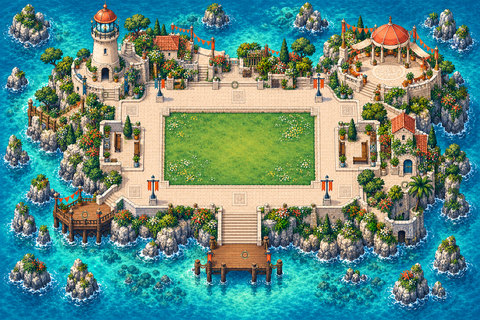

# Lighthouse stories

[← Whole collection](../../COLLECTION.md)

Two distinct scripted experiences: The Last Signal and The Keeper’s Return. These are the clearest quest-style candidates; runtime defects and engine gates are explicit.

**File links below are public import targets, not play rooms.** The original runtime backup is verified; publication checks and live acceptance are separate. Static previews are reconstructed from original TMJ / image bytes; no new art.

## Lighthouse: The Last Signal · interactive map candidate r2
**lighthouse-last-signal-r2 · Current candidate**

An exploration puzzle: visit three brass rings, collect the low/middle/high notes and restore the beacon. Includes a journal, visit-local progress, reset and optional proximity shore audio.

**Configured in the files:** spatial layout (walkability untested), quiet-zone map property, map script.

**Limits / defects:** No verified current play room; compatible deployed audio/pathfinding engine and real popup/touch/audio/multiplayer tests required.

Preserved surviving runtime, unchanged. The review record distinguishes retained authoring, historical variants and incomplete master-source recovery.

[Full original-canvas preview](./previews/lighthouse-last-signal-r2-runtime.jpg) · [Exact source files, for review](https://github.com/BAWES-Universe/universe-maps/tree/9f80f9020df16993a4d1811552b0d816d403ccb1/archive/runtime-recovery-2026-10-13/lighthouse-last-signal-r2-runtime) · [Review / feedback](https://github.com/BAWES-Universe/universe-maps/blob/backup/map-source-recovery-2026-10-13/docs/map-testing/interactive.md#lighthouse-last-signal-r2)

**Import files:**
- [lighthouse-last-signal.tmj public file](https://bawes-universe.github.io/universe-maps/recovered/2026-10-13-collection-v1/lighthouse-last-signal-r2-runtime/lighthouse-last-signal.tmj) — SHA-256 `3f0da81589faee13032922a438cdac5d3fa33ed87f22752c1b826abbde993b0e`
- [lighthouse-last-signal.wam public file](https://bawes-universe.github.io/universe-maps/recovered/2026-10-13-collection-v1/lighthouse-last-signal-r2-runtime/lighthouse-last-signal.wam) — SHA-256 `fcba829c3c6833f56b6fc04ef12d4bfc4ee0188ba1d553a7ae399e549162b7bb`

**Test next:**
- Inspect the rings and collect LOW, MIDDLE and HIGH notes; restore the beacon and check the visible completion feedback.
- Test out-of-order actions, repeat clicks, close/reopen and restart; verify progress is private to this visit and another player is unaffected.
- Enable optional shore audio with an intentional gesture; leave/re-enter its zone, reconnect and verify mute/cleanup behavior.

**Play room:** no verified room URL.

**Engine / runtime gates:**
- Native-audio and proximity behavior depend on compatible deployed engine code (#712 / #727); merged source alone is not live acceptance.
- #842 / #916 / #918 add shared camera/name-label checks; none proves map seams are fixed.

## Lighthouse: The Keeper’s Return r2
**lighthouse-keepers-return-r2 · Current candidate**

An enterable-house adventure: move through the house, workshop and lantern room, collect supplies and solve linked power, telescope, lens and signal steps. Silent, with visit-local progress.

**Configured in the files:** spatial layout (walkability untested), quiet-zone map property, map script.

**Limits / defects:** Known inherited teleport-rejection stale-position race; no verified current play room; full-game checks remain. Original authoring archive missing; exact runtime and reconstructed workflow survive.

Exact surviving runtime; original full authoring is missing. Reconstructed authoring is a separate recovery artifact.

[Full original-canvas preview](./previews/lighthouse-keepers-return-r2-runtime.jpg) · [Exact source files, for review](https://github.com/BAWES-Universe/universe-maps/tree/9f80f9020df16993a4d1811552b0d816d403ccb1/archive/runtime-recovery-2026-10-13/lighthouse-keepers-return-r2-runtime) · [Review / feedback](https://github.com/BAWES-Universe/universe-maps/blob/backup/map-source-recovery-2026-10-13/docs/map-testing/interactive.md#lighthouse-keepers-return-r2)

**Import files:**
- [enterable-lighthouse-r2/runtime/keepers-return.tmj public file](https://bawes-universe.github.io/universe-maps/recovered/2026-10-13-collection-v1/lighthouse-keepers-return-r2-runtime/enterable-lighthouse-r2/runtime/keepers-return.tmj) — SHA-256 `94bdc3c6dbd4ccf9a096b828016795083497f39da6f5f4c2ab2b8080b48634aa`
- [enterable-lighthouse-r2/runtime/keepers-return.wam public file](https://bawes-universe.github.io/universe-maps/recovered/2026-10-13-collection-v1/lighthouse-keepers-return-r2-runtime/enterable-lighthouse-r2/runtime/keepers-return.wam) — SHA-256 `4b89abbfaf6a74248027c32103c576d6662a5f24bf4df0c05f6b9322c6ee9272`

**Test next:**
- Enter and leave the house, workshop and lantern room; collect chart/key/fuse and complete power, telescope, lens and signal steps in order.
- Reproduce the inherited teleport-recovery race: interrupt/overlap room transitions, reconnect during a pending transition and verify no stale completion relocates the player.
- Repeat, cancel and restart puzzle actions; verify private visit progress, no duplicate UI/listeners and correct room recovery. The known race is not fixed by backup.

**Play room:** no verified room URL.

**Engine / runtime gates:**
- Silent puzzle experience; native audio is not its feature. The inherited teleport-recovery race is unresolved.

