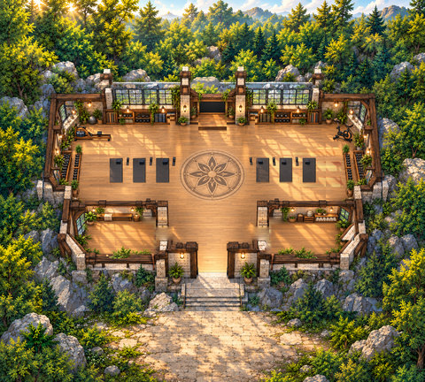
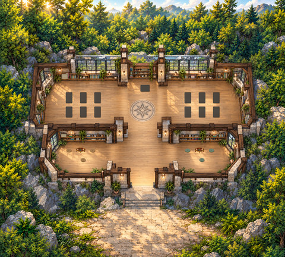
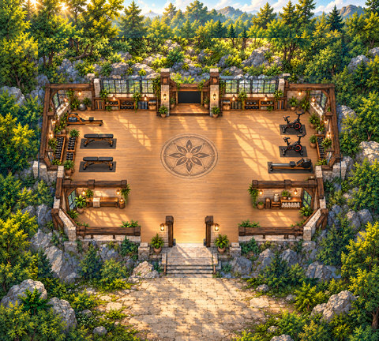
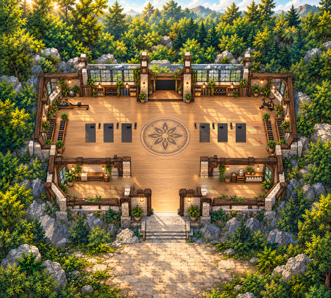
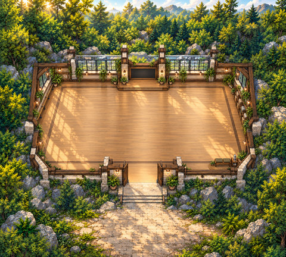

# Wellbeing designs

[← Whole collection](../../COLLECTION.md)

Studio plus four related Timber designs. Paused, rejected and unapproved revisions retain their review status.

**File links below are public import targets, not play rooms.** The original runtime backup is verified; publication checks and live acceptance are separate. Static previews are reconstructed from original TMJ / image bytes; no new art.

## Timber Studio r8
**timber-studio-r8 · Current candidate**

An instructor/participant studio with repaired continuous floor and companion WAM megaphone/listener areas.

**Configured in the files:** spatial layout (walkability untested), quiet-zone map property, WAM speaker/audience definitions.

**Limits / defects:** Configured definitions are not live service acceptance. Exact frozen r8 runtime recovered; full original authoring missing; reconstruction separate; rendering acceptance open

Exact surviving runtime; original full authoring is missing. Reconstructed authoring is a separate recovery artifact.

[Full original-canvas preview](./previews/timber-studio-r8-runtime.jpg) · [Exact source files, for review](https://github.com/BAWES-Universe/universe-maps/tree/9f80f9020df16993a4d1811552b0d816d403ccb1/archive/runtime-recovery-2026-10-13/timber-studio-r8-runtime) · [Review / feedback](https://github.com/BAWES-Universe/universe-maps/blob/backup/map-source-recovery-2026-10-13/docs/map-testing/repairs.md#timber-studio-continuous-floor-r8)

**Import files:**
- [map.tmj public file](https://bawes-universe.github.io/universe-maps/recovered/2026-10-13-collection-v1/timber-studio-r8-runtime/map.tmj) — SHA-256 `cf02f68080b959f1da5288480c3428f4aa7c9dc3e928c2f83751603a102360ca`
- [map.wam public file](https://bawes-universe.github.io/universe-maps/recovered/2026-10-13-collection-v1/timber-studio-r8-runtime/map.wam) — SHA-256 `f7de32f75df015a676fae413ca4bf9c9f90d1cd6605d46734a1c8c0ad981e44a`

**Test next:**
- Inspect the two repaired floor/plant/shadow bands at the user’s real viewport and zoom. Record a screenshot if pixelation, black edges or seams persist.
- Walk entry stairs and the north interior with native body/head dimensions; test furniture foreground depth on desktop and phone.

**Play room:** no verified room URL.

## Timber Yoga Retreat
**timber-yoga-dark-mats-r4 · Paused reference**

A twelve-student yoga-retreat design retained as a paused reference; its scenery, light and colours were kept for inspiration.

**Configured in the files:** spatial layout (walkability untested), quiet-zone map property, WAM speaker/audience definitions, WAM meeting-room definitions.

**Limits / defects:** Configured definitions are not live service acceptance. Paused/shelved reference; testing and iteration stopped

Preserved surviving runtime, unchanged. The review record distinguishes retained authoring, historical variants and incomplete master-source recovery.

[Full original-canvas preview](./previews/timber-yoga-dark-mats-r4.jpg) · [Exact source files, for review](https://github.com/BAWES-Universe/universe-maps/tree/9f80f9020df16993a4d1811552b0d816d403ccb1/archive/runtime-recovery-2026-10-13/timber-yoga-dark-mats-r4) · [Review / feedback](https://github.com/BAWES-Universe/universe-maps/blob/backup/map-source-recovery-2026-10-13/docs/map-testing/wellbeing-concepts.md#timber-retreat-visible-floor-r7)

**Import files:**
- [timber-yoga-dark-mats-r4/map32/map.tmj public file](https://bawes-universe.github.io/universe-maps/recovered/2026-10-13-collection-v1/timber-yoga-dark-mats-r4/timber-yoga-dark-mats-r4/map32/map.tmj) — SHA-256 `2137729371bbea7e248a406e462503202b6b775fd09e07cda11ef9dc7c292be6`
- [timber-yoga-dark-mats-r4/map32/map.wam public file](https://bawes-universe.github.io/universe-maps/recovered/2026-10-13-collection-v1/timber-yoga-dark-mats-r4/timber-yoga-dark-mats-r4/map32/map.wam) — SHA-256 `c6a44471f54b790b015f0e2e1327faa15769adbcf94fc8e9bfc1701002067361`

**Test next:**

**Play room:** no verified room URL.

## Timber Gym
**timber-gym-context-r3 · Rejected reference**

A gym-only layout retained as a rejected-family reference, separate from the later larger athletic-club concept.

**Configured in the files:** spatial layout (walkability untested), quiet-zone map property, WAM speaker/audience definitions, WAM meeting-room definitions.

**Limits / defects:** Configured definitions are not live service acceptance. Rejected reference; larger replacement is a separate concept

Preserved surviving runtime, unchanged. The review record distinguishes retained authoring, historical variants and incomplete master-source recovery.

[Full original-canvas preview](./previews/timber-gym-context-r3.jpg) · [Exact source files, for review](https://github.com/BAWES-Universe/universe-maps/tree/9f80f9020df16993a4d1811552b0d816d403ccb1/archive/runtime-recovery-2026-10-13/timber-gym-context-r3) · [Review / feedback](https://github.com/BAWES-Universe/universe-maps/blob/backup/map-source-recovery-2026-10-13/docs/map-testing/wellbeing-concepts.md#timber-gym-context-r4d)

**Import files:**
- [timber-gym-context-r3/map32/map.tmj public file](https://bawes-universe.github.io/universe-maps/recovered/2026-10-13-collection-v1/timber-gym-context-r3/timber-gym-context-r3/map32/map.tmj) — SHA-256 `29ffbaefd54379dfcd8a7e5f0884d859f227e83a22a3815d7d43786bd7ad49dd`
- [timber-gym-context-r3/map32/map.wam public file](https://bawes-universe.github.io/universe-maps/recovered/2026-10-13-collection-v1/timber-gym-context-r3/timber-gym-context-r3/map32/map.wam) — SHA-256 `ad6c1085f013d8d7c30f22cbd06fd286abe998bf8a7522beab41003f0a147a41`

**Test next:**

**Play room:** no verified room URL.

## Timber Mixed Six-Mat
**timber-mixed-six-mat-instructor-facing-r4 · Original preserved**

A six-mat mixed-activity arrangement facing an instructor. This r4 runtime is separate from the approved original r1 concept.

**Configured in the files:** spatial layout (walkability untested), quiet-zone map property, WAM speaker/audience definitions.

**Limits / defects:** Configured definitions are not live service acceptance. Original six-mat concept approved; later instructor-facing r4 is a separate unapproved revision

Preserved surviving runtime, unchanged. The review record distinguishes retained authoring, historical variants and incomplete master-source recovery.

[Full original-canvas preview](./previews/timber-mixed-six-mat-instructor-facing-r4.jpg) · [Exact source files, for review](https://github.com/BAWES-Universe/universe-maps/tree/9f80f9020df16993a4d1811552b0d816d403ccb1/archive/runtime-recovery-2026-10-13/timber-mixed-six-mat-instructor-facing-r4) · [Review / feedback](https://github.com/BAWES-Universe/universe-maps/blob/backup/map-source-recovery-2026-10-13/docs/map-testing/wellbeing-concepts.md#timber-mixed-six-mat-concept-r1)

**Import files:**
- [timber-mixed-six-mat-instructor-facing-r4/map32/map.tmj public file](https://bawes-universe.github.io/universe-maps/recovered/2026-10-13-collection-v1/timber-mixed-six-mat-instructor-facing-r4/timber-mixed-six-mat-instructor-facing-r4/map32/map.tmj) — SHA-256 `9291affcd0f9bb2b3051b43dc5151bfeeced5839dc43e7bac179d2d78aa1abff`
- [timber-mixed-six-mat-instructor-facing-r4/map32/map.wam public file](https://bawes-universe.github.io/universe-maps/recovered/2026-10-13-collection-v1/timber-mixed-six-mat-instructor-facing-r4/timber-mixed-six-mat-instructor-facing-r4/map32/map.wam) — SHA-256 `f7de32f75df015a676fae413ca4bf9c9f90d1cd6605d46734a1c8c0ad981e44a`

**Test next:**
- Preserve the approved original concept and compare any later arrangement against it.
- Review whether all six mats face the instructor as requested; original concept approval must not be copied onto r4.

**Play room:** no verified room URL.

## Timber Movement Studio
**timber-movement-studio-r2 · Current candidate**

An open-floor class/rehearsal studio with a modest woodland landing expansion and outdoor gathering/arrival area. The original r1 approval does not approve this expansion.

**Configured in the files:** spatial layout (walkability untested), quiet-zone map property, WAM speaker/audience definitions, WAM meeting-room definitions.

**Limits / defects:** Configured definitions are not live service acceptance. Recovered r2 expansion; original r1 approval does not approve this expansion

Preserved surviving runtime, unchanged. The review record distinguishes retained authoring, historical variants and incomplete master-source recovery.

[Full original-canvas preview](./previews/timber-movement-studio-r2.jpg) · [Exact source files, for review](https://github.com/BAWES-Universe/universe-maps/tree/9f80f9020df16993a4d1811552b0d816d403ccb1/archive/runtime-recovery-2026-10-13/timber-movement-studio-r2) · [Review / feedback](https://github.com/BAWES-Universe/universe-maps/blob/backup/map-source-recovery-2026-10-13/docs/map-testing/work-gardens.md#timber-movement-studio-r2)

**Import files:**
- [timber-movement-studio-r2/map32/map.tmj public file](https://bawes-universe.github.io/universe-maps/recovered/2026-10-13-collection-v1/timber-movement-studio-r2/timber-movement-studio-r2/map32/map.tmj) — SHA-256 `64ba9b845ef53c033454038769899f90ca491092bbb1894ee70994978963395b`
- [timber-movement-studio-r2/map32/map.wam public file](https://bawes-universe.github.io/universe-maps/recovered/2026-10-13-collection-v1/timber-movement-studio-r2/timber-movement-studio-r2/map32/map.wam) — SHA-256 `14c6f75167efd294d30be4d38a3f28d88fc1393919596ee09308355b9ae2c652`

**Test next:**
- Compare the preserved original scene/collision at the +96,+96 offset; test the 28 added south landing cells.
- Try a group class/rehearsal route between woodland landing and open floor; review expansion size and artwork.

**Play room:** no verified room URL.

